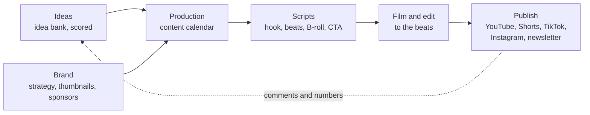

# Creator Studio

A studio for a one-person channel. Every idea gets banked, every video gets scripted, shot and cut to the same outline, and one calendar shows what goes out where and when. The business side, from sponsors to the media kit, sits in the same place, so a brand deal never lives only in your inbox.

The workspace comes with a worked example. **${channel_name}** is a fictional cooking-science channel run by ${host_name}: short, curious videos about why food does what it does, plus a weekly newsletter, **${newsletter_name}**. Every page and view already has something in it. Read it as a walkthrough, then make it yours.

## How it fits together

- **Ideas**: the **Idea bank** keeps every hook worth keeping, scored on curiosity, search demand and effort, so the next video is picked on evidence rather than mood.
- **Production**: the **Content calendar** is the hub. Every long video, Short, carousel and newsletter is a row with a status, its platforms, a pillar and a publish date. See it as a calendar, a board or a table. The newsletter row repeats every week on its own.
- **Scripts**: the [[Script template|doc:documents/Scripts/Script%20template.md]] and two worked examples, [[Script - Salt and boiling water|doc:documents/Scripts/Script%20-%20Salt%20and%20boiling%20water.md]] and [[Script - Why cookies spread|doc:documents/Scripts/Script%20-%20Why%20cookies%20spread.md]].
- **Brand**: the [[Channel strategy|doc:documents/Brand/Channel%20strategy.md]] (pillars, audience, hooks, titles), the [[Brand and thumbnails|doc:documents/Brand/Brand%20and%20thumbnails.moodboard.md]] board, the [[Media kit|doc:documents/Brand/Media%20kit.slides.md]] deck and the **Sponsors** sheet.
- **Templates**: blank pages to duplicate: a [[Short script|doc:documents/Templates/Short%20script.md]], a [[Newsletter issue|doc:documents/Templates/Newsletter%20issue.md]] and a [[Sponsor brief|doc:documents/Templates/Sponsor%20brief.md]].

## Your first 15 minutes

- [ ] Open **Production → Content calendar** and flip between the Calendar, Board and Table views
- [ ] Read [[Script - Why cookies spread|doc:documents/Scripts/Script%20-%20Why%20cookies%20spread.md]]: a finished script with hook options, beats, B-roll and a sponsor segment
- [ ] Add one idea of your own to **Ideas → Idea bank**, score it, and find it in the Ranked view
- [ ] Open the **Title check** view of the calendar and click a row to see how its title truncates on each platform
- [ ] Paste a script into the teleprompter at the bottom of the [[Script template|doc:documents/Scripts/Script%20template.md]] and try mirror mode
- [ ] Select the hook in either example script and type `/hook_punchup`

## How the pieces connect

An idea is a hook, not a topic. "Cookies" is a topic; "your cookies spread because of one thing you measured wrong" is a hook. The idea bank stores the hook with a **Score**: curiosity plus search demand plus ease, out of 15. The Ranked view puts the best bets first.

When an idea gets a slot, it moves into the content calendar with a publish date, a pillar and its platforms, and its idea bank row is marked **In calendar**. From there the status walks it through the pipeline: **Scripting**, **Filming**, **Editing**, **Scheduled**, **Published**. The progress widget on the home page moves with it.

Scripts are written in beats: what you say, what the viewer sees, and how long it takes. You film to the beats and cut to the beats, so the edit is mostly assembled before you open the timeline. Each script links to its calendar row, and the row links back.

The brand pages keep the channel consistent: four content pillars, the hook formulas, the title and thumbnail rules, and the palette. Sponsors live in a sheet with the value, deliverables and due date of every deal, and each sponsored video's row names the brand it's for.

## Make it yours

The sample story lives in the Idea bank and Content calendar rows, the two example scripts, the channel strategy, the brand board, the media kit and the sponsors sheet. Delete rows freely: the columns, views, the score formula and the weekly repeat stay. The templates are written to be kept.

Your channel name, host name, newsletter name and channel numbers are **workspace variables**. Change them once and every page that mentions them updates, including the sponsor rate in the channel strategy. The media kit deck has its numbers typed in, so refresh them when you update the kit.

## Use with AI

- `/hook_punchup` rewrites the first fifteen seconds of a script with the hook formulas from the channel strategy, and gives you three versions to read aloud.
- `/repurpose` turns a long video script into a Short, an Instagram carousel and a newsletter section, following the repurposing ladder.
- `/title_ideas` writes ten title and thumbnail-text pairs for a video, inside each platform's limits, and picks three to test.

Coding agents and desktop assistants can work here too. Point Claude Code or Cursor at this workspace folder over MCP, and they can read a script, add rows to the calendar, or move a video to Published with its date.

## Suggested routines

Routines keep the cadence going while you're busy filming. They can't come inside a template, but these take a minute to set up:

| When | Run | Why |
|---|---|---|
| Monday, 9:00 | "Read the Idea bank's Ranked view and queue the top idea that isn't in the calendar into the next open Thursday" | The next drop is always lined up |
| Wednesday, 10:00 | "Draft this week's ${newsletter_name} from the last published video, using the Newsletter issue template" | The newsletter never starts from a blank page |
| Friday, 15:00 | `/title_ideas` for next week's long video | Titles get two days to settle before the thumbnail shoot |
