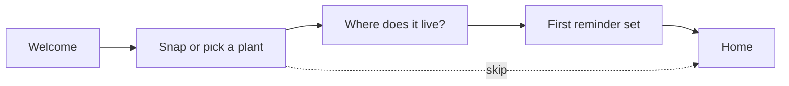

# Fernway v3 design review

~

Design team · week 5 of 8

***

## Why we're here

- Reminders people act on
- First plant in under a minute
- Accessible by default, dark mode included
- One calm visual language

Today: what we learned in usability round 2, and three decisions we need from this room.

***

## Where the system is

~bar

| Status | Components |
|---|---|
| Exploring | 2 |
| In design | 2 |
| Ready for dev | 3 |
| Shipped | 4 |

***

## What we heard

Six participants, twenty-five minutes each, clickable prototype.

~bar

| Finding | Participants |
|---|---|
| Reminder banner read as an error | 4 |
| Watering and feeding look the same | 3 |
| Diagnosis sounded too certain | 2 |
| Onboarding felt long | 1 |

***

~bg-24382d
~text-ffffff

> "I thought the orange bar meant I'd already killed it."

~

Participant 3, usability round 2

***

## Onboarding, rebuilt

Twelve questions became three. Pot size and soil moved to the plant profile, optional.

***

## The reminder banner

### Before

Terracotta for every reminder. Read as an error by four of six people.

~split

### After

Sky for routine care, Terracotta only when overdue, always with the word "Overdue". Retest in week 6.

***

## Accessibility so far

- Every text token clears 4.5:1 in light and dark mode
- Fern in dark mode went from 2.55:1 to 7.88:1 on cards
- Watering and feeding get icons and labels, not just colour
- Tab labels wrap at the largest text sizes

***

## Decisions needed

1. Does the care calendar **replace** the home list or sit **above** it?
2. Brand colours on Android, or dynamic system colours?
3. Ship the light level indicator in v3, or hold it for v3.1?

***

## Next two weeks

- Week 6: clickable prototype with the fixes, three-person retest
- Week 7: handoff, every component linked to its Figma frame
- Week 8: QA on the build with the checklist
