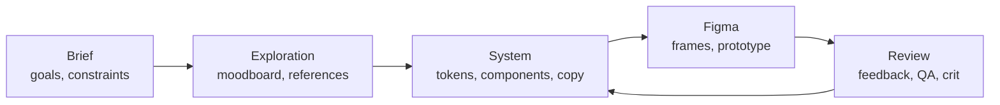

# Design Studio

A home for a design team's whole loop: the brief, the exploration, the system, and the reviews that keep it honest. Everything is a plain file, so the brief you write here is the same brief Claude reads when it builds frames for you in Figma.

The workspace comes with a worked example. **${app_name}** is a fictional plant-care app halfway through its v3 refresh: calmer visuals, a new care calendar, a faster onboarding, dark mode and a round of accessibility fixes. It's week 5 of 8 and the design review is on Thursday, so every page and view already has something in it. Read it as a walkthrough, then make it yours.

## How it fits together

- **Briefs**: the [[Project brief|doc:documents/Briefs/Project%20brief.md]] is the page everything else answers to: goals, non-goals, constraints and how success is measured.
- **Exploration**: the [[Fernway moodboard|doc:documents/Exploration/Fernway%20moodboard.moodboard.md]] holds the palette, type and mood in one board, and [[References|doc:documents/Exploration/References.md]] says what we take from each source and what we leave.
- **System**: [[Colors|doc:documents/System/Colors.md]], [[Typography|doc:documents/System/Typography.md]] and [[Voice and microcopy|doc:documents/System/Voice%20and%20microcopy.md]] are the rules. The **Components** database is the hub: one row per component with its status, platforms, owner, Figma link and when it was last reviewed. The **UX copy** sheet holds every string with its character limit.
- **Review**: the **Feedback log** database collects findings from crits and usability tests. The [[Design QA checklist|doc:documents/Review/Design%20QA%20checklist.md]] is the last gate before handoff, and the [[Design review deck|doc:documents/Review/Design%20review.slides.md]] tells the story on Thursday.
- **Templates**: blank pages to duplicate: [[Creative brief template|doc:documents/Templates/Creative%20brief%20template.md]] and [[Critique notes template|doc:documents/Templates/Critique%20notes%20template.md]].

## Your first 15 minutes

- [ ] Read the [[Project brief|doc:documents/Briefs/Project%20brief.md]] (it's short on purpose)
- [ ] Open the [[Fernway moodboard|doc:documents/Exploration/Fernway%20moodboard.moodboard.md]] and move a swatch somewhere better
- [ ] Open **System → Components** and switch between the Gallery, Board, Table and Needs review views
- [ ] Try a colour pair in the contrast checker at the bottom of [[Colors|doc:documents/System/Colors.md]]
- [ ] Add one finding from your last critique to **Review → Feedback log**
- [ ] Type `/microcopy` on a new page and ask for three ways to say "your plant needs water"

## How the pieces connect

**The brief is the top of the tree.** Every component, string and finding should trace back to a goal in the brief. If something doesn't, either it's a non-goal or the brief is missing a line.

**Exploration ends in decisions.** When a direction sticks on the moodboard, it becomes a token on Colors, a role on Typography or a rule on Voice and microcopy. The board keeps the why; the system pages keep the what.

**Components are the contract with engineering.** Status runs Exploring → In design → Ready for dev → Shipped. *Days since review* is a formula column, so anything nobody has looked at for a month floats to the top of the Needs review view. Strings live in the UX copy sheet with a limit each, so engineers and translators see exactly what you see.

**Review closes the loop.** Every finding in the Feedback log names a screen, a severity and the component it touches. Blockers stop a handoff; the QA checklist is the last pass before a screen moves to Ready for dev.

## From brief to Figma and back

1. **Write the brief here.** Goals, constraints, success metrics. Keep it to one screen.
2. **Explore on the moodboard.** Swatches, type samples, stickies and the pages they came from.
3. **Spec and copy in System.** Tokens on Colors and Typography, one row per component, every string in UX copy.
4. **Build in Figma with Claude.** Connect both the Figma and the Hillnote connectors (MCP) in Claude, then ask something like: *"Read the Project brief and the Components database in my ${app_name} workspace, and build the onboarding frames in Figma using the Colors and Typography tokens."* The brief travels with the request, so the frames start from your constraints instead of a blank prompt.
5. **Prototype.** Wire the frames into a clickable prototype in Figma and put it in front of people. Log what you learn in the Feedback log.
6. **Embed it back.** Copy the Figma file or frame link, type `/figma` on any page here and paste it: the live frame shows inside the doc. For a component, paste the link into its **Figma** column as well. The sample rows leave that column empty because the ${app_name} files are fictional.

## Make it yours

The ${app_name} story lives in the brief, the moodboard, the references, the Colors, Typography and Voice pages, the Components, Feedback log and UX copy rows, the ticks on the QA checklist and the review deck. Delete rows freely: the columns, views and the *Days since review* formula stay.

The app name, base type size, scale ratio, minimum contrast and touch target are **workspace variables**. Change `base_size` or `scale_ratio` once and every size on [[Typography|doc:documents/System/Typography.md]] recalculates; change `min_contrast` and the rules on Colors and the QA checklist follow.

## Use with AI

- `/critique` reviews a screen or flow against the brief, the QA checklist and the voice rules, in the format of the critique notes template.
- `/microcopy` writes or rewrites UI copy inside each string's character limit, following Voice and microcopy, and shows the counts.
- `/brief_to_spec` turns the brief and the Components rows into a handoff spec you can attach when Claude builds in Figma.

Coding agents can work here too. Point Claude Code or Cursor at this workspace folder over MCP, and they can read the component specs and the UX copy while they build, then move a component to Shipped when it merges.

## Suggested routines

Routines can't come inside a template, but these three take a minute to set up:

| When | Run | Why |
|---|---|---|
| Monday, 9:30 | `/critique` on the screen in focus this week | Feedback lands before anyone has polished the wrong thing |
| Wednesday, 16:00 | `/microcopy` with "review every Draft row in UX copy" | Copy is ready for the review instead of the night before |
| Friday, 15:00 | "List components with Days since review over 30 and every open Blocker in the Feedback log" | Nothing quietly rots between reviews |
