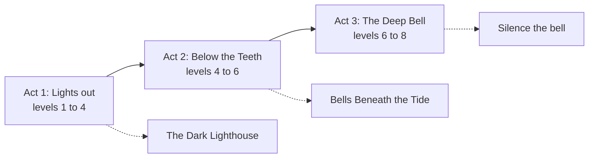

# Campaign arc

The big story in three acts, plus the clocks that keep it moving whether or not the party is watching. Milestone levelling: the party levels up at the end of each main quest and halfway through each act.

## Act 1: Lights out

**Question:** why is the Spire failing? **Ends when** the party learns the light is fed with stormglass, and that the stormglass is bought with ships.

Key quest: [[The Dark Lighthouse|doc:documents/Quests/Quests/The%20Dark%20Lighthouse.md]]. The party is level ${party_level} now, in the middle of Act 1.

## Act 2: Below the Teeth

**Question:** who is buying the ships? **Ends when** the party meets the Choir and learns what the Deep Bell can do.

Key quest: [[Bells Beneath the Tide|doc:documents/Quests/Quests/Bells%20Beneath%20the%20Tide.md]]. The Guildmaster becomes an uneasy ally or an enemy, depending on how Act 1 ended.

## Act 3: The Deep Bell

**Question:** can the bell be silenced, and what happens to the light if it is? **Ends** in [[The Sunken Stair|doc:documents/World/Places/The%20Sunken%20Stair.md]], against [[The Choirmother|doc:documents/Cast/NPCs/The%20Choirmother.md]].

The final choice: silencing the Deep Bell kills the Choirmother but ends the stormglass, and the Spire goes dark for good. The coast will have to find another way to keep its ships safe.

## Clocks

Tick a segment when a faction advances (see the faction turns on [[Factions|doc:documents/Cast/Factions.md]]) or when the party ignores a problem.

| Clock | Progress | When it fills |
|---|---|---|
| **The Choir's song** | ●●●○○○○○ (3 of 8) | The Choirmother rings the Deep Bell. Veyr rises, and Lanternfall floods |
| **The light fails** | ●●●●○○ (4 of 6) | The Spire goes dark in the first winter storm. A fleet breaks on the Teeth |
| **The Compact's patience** | ●●○○○○ (2 of 6) | The Compact shuts the port and hires mercenaries to storm the Spire |
| **Wren's debt** | ●○○○ (1 of 4) | The Gull Court comes to collect, from the whole party |

## If the party ignores it

- **Next month:** another ship vanishes on a calm night; the bells grow louder in Saltmarrow.
- **Two months:** cultists appear openly in Lanternfall, singing on Lamp Street.
- **Three months:** the Choir's clock fills.
