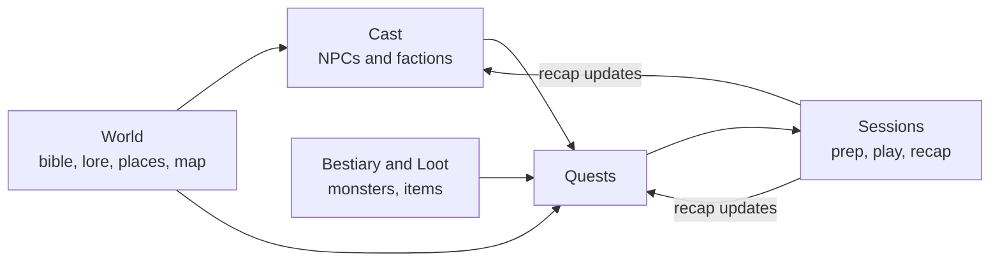

# Dungeon Master's Codex

Your campaign, in one place, with everything linked. NPCs know where they live, places know who lives there, quests know who gave them, and the session you are prepping can reach all of it in one click. It works with 5e or any d20 game.

It comes with a worked example: **The Shattered Coast**, an original nautical-gothic setting. Twelve years ago the great lighthouse on the Teeth went dark for a single night. Since then it has burned a little dimmer every year, ships vanish, and on still nights the fishermen of Saltmarrow hear bells ringing under the sea. **${party_name}** have just been hired to find out why.

In the story it is the ${in_world_date}, and session ${session_number} is next. Everything is filled in, so you can read tonight's prep and see how the pieces fit before you build your own world.

## How it fits together

- **World**: the [[Campaign bible|doc:documents/World/Campaign%20bible.md]] (pitch, tone, truths and secrets), [[Lore and timeline|doc:documents/World/Lore%20and%20timeline.md]], the **Places** database and the [[Region map|doc:documents/World/Region%20map.moodboard.md]], a board where every place is a card that opens its notes.
- **Cast**: the **NPCs** database is the hub. Each NPC has a role, faction, home, attitude, a voice to play and a secret to protect. Open it as a gallery, a board by faction or a table. [[Factions|doc:documents/Cast/Factions.md]] explains what each group wants.
- **Bestiary and Loot**: **Monsters** with compact stat blocks and tactics, **Items** with rarity, value and who holds them, and a page on [[Encounter building|doc:documents/Bestiary%20and%20Loot/Encounter%20building.md]].
- **Quests**: the **Quests** database runs from Rumor to Active to Complete (or Failed), and the [[Campaign arc|doc:documents/Quests/Campaign%20arc.md]] tracks the big story with progress clocks.
- **Sessions**: a calendar of sessions with a weekly prep reminder, the [[Session 1 recap|doc:documents/Sessions/Sessions/Session%201%20-%20The%20Drowned%20Bell.md]], the [[Session 2 prep|doc:documents/Sessions/Sessions/Session%202%20-%20Lights%20on%20the%20Teeth.md]], the [[Session zero|doc:documents/Sessions/Session%20zero.slides.md]] deck and a [[DM screen|doc:documents/Sessions/DM%20screen.md]] with the dice roller and initiative tracker.
- **Templates**: [[Session prep|doc:documents/Templates/Session%20prep.md]] and [[NPC|doc:documents/Templates/NPC.md]], ready to duplicate.

## Your first 15 minutes

- [ ] Read the [[Campaign bible|doc:documents/World/Campaign%20bible.md]]. It is the one page every other page assumes you know
- [ ] Open **Cast → NPCs**, switch to the By faction board and open [[Corvin Hale|doc:documents/Cast/NPCs/Corvin%20Hale.md]]
- [ ] Open the [[Region map|doc:documents/World/Region%20map.moodboard.md]] and click a place card to jump into its notes
- [ ] Read the [[Session 2 prep|doc:documents/Sessions/Sessions/Session%202%20-%20Lights%20on%20the%20Teeth.md]], the next session's plan
- [ ] Open the [[DM screen|doc:documents/Sessions/DM%20screen.md]] on your phone and roll a d20 with advantage
- [ ] Type `/npc_voice` and ask how [[Odile Marr|doc:documents/Cast/NPCs/Odile%20Marr.md]] greets the party tonight

## How the pieces connect

**Links do the work.** Every NPC row links to the place they live and the quests they give. Every place lists the NPCs found there. Every quest names its giver and its location. Open any page and the backlinks show everything that points at it, so "who knows about the bells?" is one click away.

**Secrets live in one column.** The *Secret* column on NPCs is the truth the players haven't found yet. Switch to the **Player-safe** view when you screen-share: it hides secrets and attitudes and shows only the NPCs the party has met. The AI recipes protect secrets too. The **Not seen lately** view lists recurring NPCs by the last time the party saw them, so nobody important drops out of the story.

**Sessions close the loop.** Prep pulls in NPCs, places, monsters and loot by link. After the game, the recap updates the world: NPC status moves from Unmet to Introduced, quests move across the board, items change hands. The world you prep from next week is the world your players left.

**Topics track the mysteries.** Every page that touches a clue thread carries its topic: #stormglass for what feeds the light, #bells for what sings under the sea. Open a topic to see every NPC, place, quest and session it appears in, which is the fastest way to check what the players could know before you reveal the next piece.

**The map is a board, not a picture.** Regions are frames, places are cards that open their notes, and roads are connectors labelled with travel time. Drag a card when the party discovers somewhere new.

## Make it yours

The Shattered Coast lives in the rows of every database, the bible, the lore, the factions, the map and the session pages. Delete the rows when you are ready: the columns, views, formulas and the weekly prep reminder stay. Or keep the coast as a starting region and build outwards.

Everything here is original and generic: invented creatures, gods, places and factions, with stat blocks written for any d20 game. Bring your own rules system.

The party name, session number, in-world date, party size and level are **workspace variables**. Change them once after each session and every page that mentions them follows, including the reward split and the encounter maths.

## Use with AI

- `/npc_voice` plays any NPC in character: their voice, what they want, what they'll say and what they'll never admit, grounded in their row, their faction and their home.
- `/side_quest` spins a side quest out of your own lore: a hook, an NPC to give it, a place to run it, monsters at the right level and a reward from your loot table.
- `/session_recap` turns your scrappy session notes into a "previously on" to read aloud, plus the updates the world needs.

Point Claude Code or Cursor at this workspace folder over MCP and it can do the bookkeeping too: add the NPCs the players met, move quests across the board, and log who picked up which item.

## Suggested routines

Routines can't come inside a template, but these take a minute to set up:

| When | Run | Why |
|---|---|---|
| The morning after each session | `/session_recap` on your notes | The recap is ready before you forget who stole the lantern |
| Wednesday, 19:00 | Open the weekly prep row and duplicate Session prep | Prep happens midweek, not an hour before the game |
| Once a month | `/side_quest` | A fresh rumour for the tavern board whenever the party goes off-script |

**Pages:** [[Session prep|doc:documents/Templates/Session%20prep.md]]
