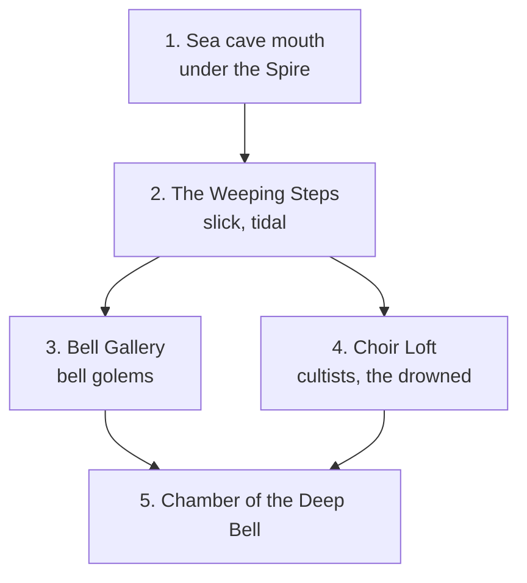

> The stair is wider than a street and every step is carved with bells. It goes down into water that should be black and isn't: far below, something is lit. You can hear singing.

## Rooms

1. **Sea cave mouth.** Reached from the Spire's lower vaults, or by boat at low tide.
2. **The Weeping Steps.** Half-flooded; the tide rises one step every ten minutes. [[Brinewights|doc:documents/Bestiary%20and%20Loot/Monsters/Brinewight.md]] wait in the water.
3. **Bell Gallery.** Hundreds of bells, two of them not bells at all: [[bell golems|doc:documents/Bestiary%20and%20Loot/Monsters/Bell%20Golem.md]].
4. **Choir Loft.** [[Tidecaller cultists|doc:documents/Bestiary%20and%20Loot/Monsters/Tidecaller%20Cultist.md]] and the drowned they have raised, singing.
5. **Chamber of the Deep Bell.** [[The Choirmother|doc:documents/Cast/NPCs/The%20Choirmother.md]], and the Deep Bell itself.

## Secrets

The air pocket around the stair exists because the Deep Bell is still faintly ringing. Silence it and the sea comes in.

## Loot

[[Bell-shard of Veyr|doc:documents/Bestiary%20and%20Loot/Items/Bell-shard%20of%20Veyr.md]], stormglass worth a fortune, and whatever the drowned were wearing.
