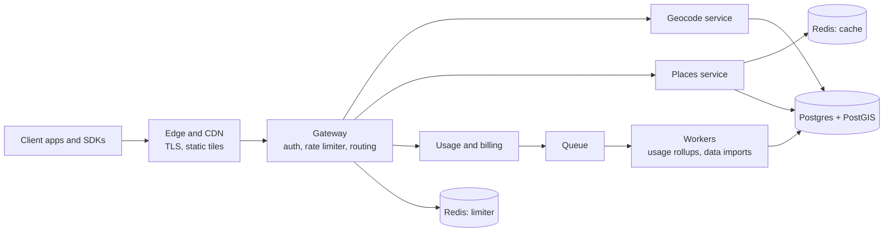

# Architecture overview

${service} answers two questions for developers: *where is this address?* (geocode and reverse geocode) and *what is near this point?* (places search and place details). About 2,400 customer [[API keys|doc:documents/Specs/Glossary.md#api-key]] call it, from delivery apps to real-estate sites, and peak traffic is ${peak_rps} requests per second on weekday lunchtimes.

:::toc "On this page"
:::

## The big picture

## Components

| Component | Owns | Owner |
|---|---|---|
| Gateway | Auth, the rate limiter, routing, request IDs | Aiko Tanaka |
| Geocode service | Forward and reverse geocoding | Lena Fischer |
| Places service | Places search, place details, the result cache | Sam Okoro |
| Usage and billing | Counting requests per key, monthly invoices | Tomás Reyes |
| Workers | Usage rollups, nightly address-data imports | Tomás Reyes |
| Docs and SDKs | API reference, client libraries | Ravi Menon |

## The life of a request

1. The edge terminates TLS and forwards the request with a request ID.
2. The gateway checks the [[API key|doc:documents/Specs/Glossary.md#api-key]] and finds its [[tenant|doc:documents/Specs/Glossary.md#tenant]] and tier.
3. The rate limiter takes a token from the key's [[token bucket|doc:documents/Specs/Glossary.md#token-bucket]]. No token means a `429` with `Retry-After` (see [[RFC-001|doc:documents/Specs/RFC-001%20Rate%20limiting.md]]).
4. The gateway routes to geocode or places. Places checks the Redis cache first and falls back to PostGIS.
5. The response goes back with `RateLimit-*` headers, and a usage event goes onto the queue for billing.

List endpoints page with an opaque [[cursor|doc:documents/Specs/Glossary.md#cursor]], never with offsets (see [[ADR-003|doc:documents/Decisions/ADRs/ADR-003%20Cursor-based%20pagination%20for%20list%20endpoints.md]]).

## Data stores

- **Postgres + PostGIS** is the source of truth for addresses, places and accounts ([[ADR-001|doc:documents/Decisions/ADRs/ADR-001%20Postgres%20with%20PostGIS%20as%20the%20primary%20store.md]]).
- **Redis (cache)** holds popular search results for 15 minutes. Losing it is survivable but slow, which is exactly what the [[places search incident|doc:documents/Runbooks/Postmortem%20-%20Places%20search%20latency.md]] proved.
- **Redis (limiter)** holds one small bucket per key. If it is unreachable the limiter fails open with a local in-memory bucket.

## SLOs

| SLO | Target | Measured at |
|---|---|---|
| Availability | ${slo_availability}% of requests succeed, per 30 days | Gateway |
| Latency: places search | 99% of requests under 300 ms (p99) | Gateway |
| Latency: geocode | 99% of requests under 200 ms | Gateway |
| Freshness | Address data at most 48 hours old | Import workers |

**Pages:** [[p99|doc:documents/Specs/Glossary.md#p99]]

An availability SLO of ${slo_availability}% leaves an [[error budget|doc:documents/Specs/Glossary.md#error-budget]] of **${=round((100 - slo_availability) / 100 * 30 * 24 * 60, 1)} minutes** of full downtime per 30 days. When the budget is spent, feature work pauses and reliability work goes to the top of the board.

## Capacity

Peak is ${peak_rps} requests per second. We load test at three times peak, **${=peak_rps * 3} requests per second**, before any change to the gateway or the cache, and we keep enough database headroom to survive a cold cache at peak.

## Decisions that shaped this

- [[ADR-001 Postgres with PostGIS as the primary store|doc:documents/Decisions/ADRs/ADR-001%20Postgres%20with%20PostGIS%20as%20the%20primary%20store.md]]
- [[ADR-003 Cursor-based pagination for list endpoints|doc:documents/Decisions/ADRs/ADR-003%20Cursor-based%20pagination%20for%20list%20endpoints.md]]
- [[ADR-004 Canary deploys with automatic rollback|doc:documents/Decisions/ADRs/ADR-004%20Canary%20deploys%20with%20automatic%20rollback.md]]
- [[ADR-005 Token bucket rate limiting in the gateway|doc:documents/Decisions/ADRs/ADR-005%20Token%20bucket%20rate%20limiting%20in%20the%20gateway.md]] (replaces [[ADR-002|doc:documents/Decisions/ADRs/ADR-002%20Fixed-window%20rate%20limiting%20at%20the%20edge.md]])

## What is changing

Rate limiting moves from the edge into the gateway, per [[RFC-001 Rate limiting|doc:documents/Specs/RFC-001%20Rate%20limiting.md]]. It runs in [[shadow mode|doc:documents/Specs/Glossary.md#shadow-mode]] this sprint and starts enforcing for the free tier next sprint.
