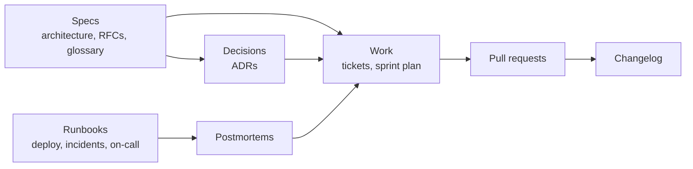

# Engineering Hub

One place for how your service is built, what the team is building right now, why it was built that way, and what to do when it breaks. Specs, tickets, decisions and runbooks are plain markdown files, so the folder your coding agent reads is the same one your team plans in.

The workspace comes with a worked example. **${service}** is the public geocoding and places API of Cobalt Labs, a fictional company, run by a six-person platform team in the second week of Sprint 15. They are shipping rate limiting, and last week they had an incident. Every page and view already has something in it, so read it as a walkthrough, then make it yours.

## How it fits together

- **Specs**: the [[Architecture overview|doc:documents/Specs/Architecture%20overview.md]] (one diagram, the SLOs, the request path), [[RFC-001 Rate limiting|doc:documents/Specs/RFC-001%20Rate%20limiting.md]] and the [[Glossary|doc:documents/Specs/Glossary.md]]. Every glossary term has its own anchor, so other pages link straight to the definition, like [[error budget|doc:documents/Specs/Glossary.md#error-budget]].
- **Work**: the **Tickets** database is the hub. Open it as a Board, the Current sprint, the Bugs queue, points By type, or the Changelog view that drafts release notes from finished tickets. The [[Sprint plan|doc:documents/Work/Sprint%20plan.md]] and the [[Sprint review|doc:documents/Work/Sprint%20review.slides.md]] deck sit beside it.
- **Decisions**: the **ADRs** database holds one architecture decision record per row: context, decision, consequences. The team started keeping ADRs this quarter, which is why the log begins at ADR-001 with a decision written down after the fact.
- **Runbooks**: [[Deploy|doc:documents/Runbooks/Deploy.md]], [[Incident response|doc:documents/Runbooks/Incident%20response.md]], [[On-call|doc:documents/Runbooks/On-call.md]], the [[Changelog|doc:documents/Runbooks/Changelog.md]] and a filled-in [[postmortem for the places search incident|doc:documents/Runbooks/Postmortem%20-%20Places%20search%20latency.md]].
- **Templates**: blank pages to duplicate: [[Design doc template|doc:documents/Templates/Design%20doc%20template.md]], [[ADR template|doc:documents/Templates/ADR%20template.md]] and [[Postmortem template|doc:documents/Templates/Postmortem%20template.md]].

## Your first 15 minutes

- [ ] Read the [[Architecture overview|doc:documents/Specs/Architecture%20overview.md]]: one diagram, four SLOs, five minutes
- [ ] Open **Work → Tickets** and switch between Board, Current sprint, Bugs, By type and Changelog
- [ ] On the Changelog view, pick Sprint 15, type a version number and press **Copy markdown**
- [ ] Follow one story end to end: [[RFC-001|doc:documents/Specs/RFC-001%20Rate%20limiting.md]] → [[ADR-005|doc:documents/Decisions/ADRs/ADR-005%20Token%20bucket%20rate%20limiting%20in%20the%20gateway.md]] → the [[limiter ticket|doc:documents/Work/Tickets/Token-bucket%20rate%20limiter%20in%20the%20gateway.md]]
- [ ] Open [[Incident response|doc:documents/Runbooks/Incident%20response.md]] and start a practice incident in the Incident log, then discard it
- [ ] Type `/standup` on a new page and read what it says about Sprint 15

## How the pieces connect

**Specs before tickets.** Anything bigger than a few days of work gets a design doc or an RFC before it gets tickets. When an RFC is accepted, the decision goes into the ADR log in one page, and the work goes onto the board as tickets that link back to both. Six months from now, "why does the limiter fail open?" has an answer one click from the code.

**Tickets and pull requests point at each other.** Put the ticket name in the PR description and paste the PR link into the ticket's **PR** column. The sample links point at `github.example.com`, so they are placeholders: replace them with your own. When the PR merges, move the ticket to Done and the Done points formula and the progress widget on the home page move with it.

**Done tickets become the changelog.** The Changelog view groups finished tickets into Added, Changed, Fixed and Docs, with PR numbers, ready to paste into the [[Changelog|doc:documents/Runbooks/Changelog.md]]. Edit the wording for the people calling your API, not for the people who wrote it.

**Incidents become tickets.** During an incident, the scribe keeps the timeline in the Incident log tool. Afterwards, `/postmortem` turns that timeline into a blameless postmortem, and every action item becomes a ticket. The [[places search postmortem|doc:documents/Runbooks/Postmortem%20-%20Places%20search%20latency.md]] shows the whole loop, down to the [[TTL jitter ticket|doc:documents/Work/Tickets/Stagger%20cache%20TTLs%20with%20jitter.md]] it produced.

## Make it yours

The Atlas story lives in the Tickets and ADR rows, the RFC, the sprint plan, the review deck, the changelog and the postmortem. Delete rows freely: the columns, views, the Done points formula and the Changelog view stay.

The service name, the availability SLO, peak traffic and the default rate limit are **workspace variables**. Change them once in Variables and the architecture page, the RFC and the runbooks follow. The error budget on the architecture page is calculated from the SLO, so it updates too.

Rename the sprints in the Sprint column's options when you start your own, and keep the Current sprint view's filter pointing at the sprint you are in.

## Use with AI

- `/standup` reads the sprint plan and the Tickets database and writes today's standup, grouped by person, with blockers and the points left.
- `/draft_adr` turns a decision (or the RFC on the current page) into a numbered ADR with context, decision, consequences and the alternatives you rejected.
- `/postmortem` takes the timeline you copy out of the Incident log and writes a blameless postmortem with owned, prioritised action items.

Coding agents work from the same files. Point Claude Code or Cursor at this workspace folder over MCP: they can read the RFC and a ticket's acceptance criteria before writing code, look terms up in the Glossary, and move the ticket to In review with the PR link when they open the pull request.

## Suggested routines

Routines can't come inside a template, but these take a minute to set up:

| When | Run | Why |
|---|---|---|
| Weekdays, 9:45 | `/standup` | The update is written before standup starts, so the meeting is about blockers |
| Last Friday of each sprint | "Draft the changelog for this sprint from the Tickets database" | Release notes are ready for the sprint review |
| The morning after any SEV1 or SEV2 | `/postmortem` | The timeline is fresh and the action items land on the board within a day |
