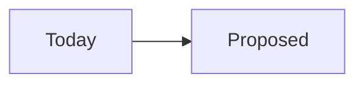

# Design doc: Name of the change

> One sentence: what changes, for whom, and why now.

:::toc "On this page"
:::

## Context

What exists today, what's wrong with it, and how we know. Numbers beat adjectives: latency, error rates, support tickets, cost.

## Goals and non-goals

**Goals**

- What must be true when this is done?

**Non-goals**

- What are we deliberately not doing, so nobody assumes we are?

## Proposal

How it works. Start with a diagram, then the parts that matter: data model, API changes, the algorithm, where it runs.

## Alternatives considered

| Option | Why not |
|---|---|
|  |  |

## Risks and failure modes

What happens when a dependency is down, slow or wrong? Fail open or closed, and why?

## Rollout

Flags, shadow mode, who goes first, how to roll back.

## Success metrics

How will we know it worked, and when will we look?

## Open questions

- [ ]

## Tickets and decisions

Link the tickets this produces, and the ADR once the decision is made.
