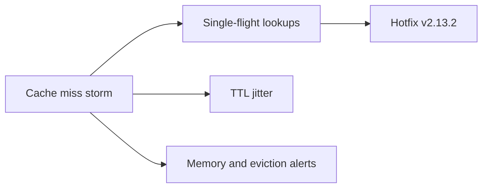

# Atlas API: Sprint 15 review

~

Platform team · sprint review and demo

***

## The goal

Rate limiting runs in **shadow mode** on every request, and places search stays inside its **300 ms p99** SLO.

~

Forecast for Friday: shadow mode on, latency SLO met after the hotfix.

***

## Where the points went

~bar

| Type | Points |
|---|---|
| Feature | 14 |
| Bug | 6 |
| Chore | 5 |
| Docs | 2 |

***

## Shipped

### Shadow-mode metrics

Who *would* be limited, per tier, per hour, before anyone is.

~split

### Two fixes

- Empty geocode queries return **400**, not 500
- Places search no longer stampedes the database on a cache miss

***

~bg-1e1b4b
~text-ffffff

## The incident

Places search p99 went from **180 ms to 2.4 s** for **38 minutes**.

~

0.6% of search requests timed out. A third of the month's latency budget, gone in one afternoon.

***

## What we changed

Blameless postmortem on the Runbooks page. Two follow-ups are on the board.

***

## In flight

1. **Token-bucket limiter**: in progress, lands behind the shadow flag Thursday
2. **429 and RateLimit headers**: in review
3. **Signed pagination cursors**: in progress, security fix

***

## Carried over

- **Load test at 3x peak**: moves to Sprint 16, after the limiter
- **Forecast**: 24 of 27 points done

The incident took the 5-point buffer. That is what it was for.

***

## Next sprint

- Enforce limits for the **free tier**
- **Per-key overrides** in the admin console
- Rate-limit docs live before paid tiers are touched

***

## Decisions we need

| Question | Proposal |
|---|---|
| ADR-006: OpenAPI as the source of truth? | Accept; docs and SDKs generate from it |
| Second on-call during free-tier enforcement week? | Yes, Lena as secondary |
