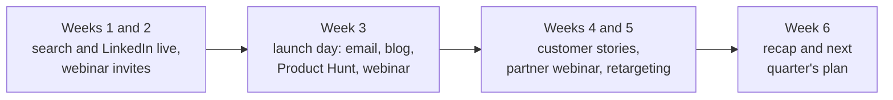

# Q4 launch brief

The launch of **${feature}**, ${product}'s automation layer, to agencies and consultancies. This is the umbrella brief: each campaign in the **Campaigns** database has its own row and links back here.

:::toc "On this page"
:::

## Summary

${feature} launches on the Tuesday of week 3. For six weeks around it, every channel carries one message: ${product} is the CRM that does the follow-up for you. The job is trials from agencies that fit the profile, not traffic.

## Objective and targets

| Measure | Target |
|---|---|
| Trials from the launch | ${trial_target} |
| Activated trials: three deals moved by ${feature} in the first week | ${=round(trial_target * 0.4)} |
| Budget for the quarter | $${=round(q4_budget / 1000)}k |
| Cost per trial, ceiling | $${=round(q4_budget / trial_target)} |

If 15% of those trials convert at an average of eight seats, the launch adds about **$${=round(trial_target * 0.15 * 8 * price_per_seat * 12 / 1000)}k** in annual recurring revenue.

## Audience

Primary: the **agency owner** from [[ICP and personas|doc:documents/Research/ICP%20and%20personas.md]]. Secondary: the ops lead, who will set it up.

## Insight

Agencies don't lose deals in the pitch. They lose them in the follow-up gap: the days between "send us a proposal" and "we've gone with someone else". Every CRM promises visibility; none of them does the follow-up. #follow-up-gap

## Proposition

From the [[Messaging house|doc:documents/Research/Messaging%20house.md]]: **the CRM that does the follow-up for you.**

## Offer

A 30-day trial instead of 14 for launch sign-ups, with ${feature} switched on and three agency templates preloaded.

## Channels and budget

- [[LinkedIn ads - agency owners|doc:documents/Campaigns/Campaigns/LinkedIn%20ads%20-%20agency%20owners.md]]: paid social, $14,000
- [[Google Ads - CRM for agencies|doc:documents/Campaigns/Campaigns/Google%20Ads%20-%20CRM%20for%20agencies.md]]: search, $12,000
- [[Partner co-marketing - Brightbooks|doc:documents/Campaigns/Campaigns/Partner%20co-marketing%20-%20Brightbooks.md]]: partners, $4,000
- [[Customer story series|doc:documents/Campaigns/Campaigns/Customer%20story%20series.md]]: content, $3,500
- [[Launch webinar|doc:documents/Campaigns/Campaigns/Launch%20webinar.md]]: events, $3,000
- [[Retargeting - pricing page visitors|doc:documents/Campaigns/Campaigns/Retargeting%20-%20pricing%20page%20visitors.md]]: paid social, $3,000
- [[Product Hunt launch|doc:documents/Campaigns/Campaigns/Product%20Hunt%20launch.md]]: community, $1,500
- [[Launch email sequence|doc:documents/Campaigns/Campaigns/Launch%20email%20sequence.md]]: email, $500

The rest of the quarter's budget stays with the always-on SEO cluster and win-back emails. Live spend and pacing are in **Campaigns**, and its Budget by channel chart shows the split.

## Sequence

## Launch day run-sheet

- [ ] 8:00 Blog post live: [[Introducing Autopilot|doc:documents/Content/Content%20calendar/Introducing%20Autopilot.md]]
- [ ] 8:01 Product Hunt listing live
- [ ] 9:00 Launch email to the full list
- [ ] 9:30 Founder post on LinkedIn; the team reshares within the hour
- [ ] 12:00 Check tagged traffic by source
- [ ] 16:00 Webinar reminder to everyone registered
- [ ] 17:00 First-day numbers to the team

## Measurement

Every link carries UTM tags, built with the UTM builder in the **UTM links** view of Campaigns. The conventions:

- `utm_source` is where the click happened: linkedin, google, newsletter, brightbooks, producthunt
- `utm_medium` is the kind of channel: paid-social, cpc, email, referral, webinar
- `utm_campaign` comes from the campaign's **UTM campaign** column: `q4-launch` for everything in this brief
- `utm_content` is the creative or link position: founder-video, carousel-a, footer-link
- Lowercase, hyphens, no spaces. Always.

Weekly numbers go into the **Weekly metrics** sheet every Monday.

## Risks

| Risk | Plan |
|---|---|
| Product Hunt clashes with a bigger launch that day | Keep the date flexible until the Friday before |
| LinkedIn costs climb in the last weeks of the year | Front-load the spend and cap the daily budget |
| Trials that never activate | Onboarding emails on day 1 and day 3; the ops lead as secondary audience |

## Approvals

- [x] Messaging signed off by Marcus
- [x] Budget signed off by Dana
- [x] Launch date confirmed with product
- [ ] Partner webinar date confirmed with Brightbooks
