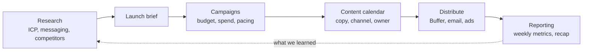

# Marketing Hub

Everything a small marketing team needs to go from research to a running campaign, in one place: who you're talking to, what you're saying, which campaigns carry it, what gets published when, and whether any of it is working.

The workspace comes with a worked example. **${product}** is a fictional CRM for agencies and consultancies, launching **${feature}**, a set of automations that do the follow-up for you. The team is planning the quarter around that launch, so every page and view already has something in it. Read it as a walkthrough, then make it yours.

## How it fits together

- **Research**: [[ICP and personas|doc:documents/Research/ICP%20and%20personas.md]] says who the product is for, the [[Messaging house|doc:documents/Research/Messaging%20house.md]] says what to tell them, and the **Competitors** database keeps track of everyone else's positioning and pricing.
- **Campaigns**: the **Campaigns** database is the hub. Every campaign has a goal, a lead channel, an owner, a budget, its spend so far and a pacing formula. See it as a timeline, a board or a budget-by-channel chart. The filled-in [[Q4 launch brief|doc:documents/Campaigns/Q4%20launch%20brief.md]] ties the launch together.
- **Content**: the **Content calendar** holds every post, article and email with drafted copy, typed by status, channel, campaign and owner.
- **Reporting**: the **Weekly metrics** sheet, a [[Monthly report template|doc:documents/Reporting/Monthly%20report%20template.md]] and the [[Campaign recap|doc:documents/Reporting/Campaign%20recap.slides.md]] deck.
- **Templates**: a blank [[Campaign brief|doc:documents/Templates/Campaign%20brief.md]] to duplicate for the next campaign.

## Your first 15 minutes

- [ ] Read the [[Messaging house|doc:documents/Research/Messaging%20house.md]]; it's one page and everything else hangs off it
- [ ] Open **Campaigns → Campaigns** and switch between the Timeline, Board and Budget by channel views
- [ ] Open the **UTM links** view, pick a campaign, and build a tagged link
- [ ] Open a draft in the **Content calendar** and paste it into the channel character counter on the [[Messaging house|doc:documents/Research/Messaging%20house.md]]
- [ ] Add one competitor you actually worry about to **Research → Competitors**
- [ ] Type `/weekly_report` on a new page and watch it write this week's update

## How the pieces connect

Research comes first and changes slowly. The ICP decides who you target; the messaging house decides what you say. Clip competitor pages and market research to markdown with the web clipper or your research assistant, and link them from the competitor rows, so the evidence sits next to the conclusion.

A campaign starts as a brief. Duplicate the Campaign brief template, fill it in, and add a row to Campaigns with the goal, lead channel, owner, budget and dates. **Pacing %** compares spend with budget, and **Cost per trial** divides spend by the trials it brought in, so a campaign that's burning money shows up on the board before the month ends.

Content serves campaigns. Every row in the content calendar names its campaign, channel and owner. When a post is ready, schedule it in Buffer or your own scheduler and move the row to **Scheduled**; the row stays the source of truth for the copy.

Reporting closes the loop. Every Monday the weekly numbers go into the Weekly metrics sheet, the weekly report goes to the team, and once a month the template turns them into a story.

## Make it yours

The ${product} story lives in the Competitors, Campaigns and Content calendar rows, the research pages, the launch brief, the weekly metrics and the recap deck. Delete rows freely: the columns, views and formulas stay. The templates are written to be kept.

The product name, the launch feature, the quarter's budget, the trial target and the price are **workspace variables**. Change them once and every page that mentions them updates, including the targets and cost-per-trial ceiling in the launch brief. The recap deck has its numbers typed in, so update them when you present it.

## Use with AI

- `/campaign_brief` drafts a complete brief for a new campaign from the template, the ICP and the messaging house.
- `/repurpose_post` turns one piece of content into posts for LinkedIn, X, email and search, each inside its channel's limits.
- `/weekly_report` writes the Monday update from the Weekly metrics sheet and the Campaigns database.

Coding agents and desktop assistants can work here too. Point Claude Code or Cursor at this workspace folder over MCP, and they can read the brief, add rows to the content calendar, or update a campaign's spend from an export.

## Suggested routines

Routines run the repetitive parts on a schedule. They can't come inside a template, but these take a minute to set up:

| When | Run | Why |
|---|---|---|
| Monday, 9:00 | `/weekly_report` | The report is written before the team meeting |
| Wednesday, 10:00 | "Draft this week's newsletter from the Content calendar's published posts, in the messaging house's voice" | The recurring newsletter never starts from blank |
| Friday, 14:00 | "Find the next Content calendar row still in Drafting and remind its owner what's due" | The next post is nudged into the queue |
