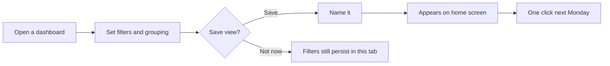

# PRD: Saved dashboards

> Let ops leads save a dashboard's filters, grouping and date range, and reopen it in one click, so the Monday rebuild disappears.

:::toc "On this page"
:::

## Summary

A [saved dashboard]{#definition} is a named set of filters, grouping, date range and layout on top of an existing dashboard. Anyone in the account can open it, and its owner can update it. It is the smallest change that removes the twenty-minute Monday rebuild our ops leads describe, and it is the foundation for [[KPI pins|doc:documents/Planning/Roadmap/KPI%20pins.md]] and [[Client share links|doc:documents/Planning/Roadmap/Client%20share%20links.md]].

**Primary persona:** the ops lead. **Secondary:** the dispatcher, who mostly benefits from filters that survive a tab switch. See [[Personas|doc:documents/Strategy/Personas.md]].

## Problem

Ops leads rebuild the same view every week before their ops meeting, and dispatchers lose their filters when they switch tabs.

- [[Rebuilding the same view every Monday|doc:documents/Discovery/Feedback/Rebuilding%20the%20same%20view%20every%20Monday.md]] (14 votes)
- [[Filters reset when switching tabs|doc:documents/Discovery/Feedback/Filters%20reset%20when%20switching%20tabs.md]]
- [[Pin three KPIs to the top of every dashboard|doc:documents/Discovery/Feedback/Pin%20three%20KPIs%20to%20the%20top%20of%20every%20dashboard.md]]

Usage data agrees: 63% of Monday sessions start with the same filter changes as the previous Monday.

## Goals and non-goals

**Goals**
- Opening a saved dashboard takes one click from the home screen.
- Filters survive a tab switch and a reload.
- Saved dashboards are shared across the account by default.

**Non-goals**
- Scheduled exports or emails of a saved dashboard (that's [[Alert digests|doc:documents/Planning/Roadmap/Alert%20digests.md]]).
- Sharing outside the account (that's [[Client share links|doc:documents/Planning/Roadmap/Client%20share%20links.md]]).
- Per-user permissions on a saved dashboard (that's [[View-only roles|doc:documents/Planning/Roadmap/View-only%20roles.md]]).

## Success metrics

| Metric | Today | Target (6 weeks after launch) |
|---|---|---|
| Active accounts with ≥ 1 saved dashboard | 0% | 50% |
| Monday sessions that start with filter changes | 63% | 30% |
| Median time from login to first dashboard view | 28s | 15s |

These move key results under Objective 1 on the [[OKRs|doc:documents/Strategy/OKRs.md]] page.

**The bet:** saving a view removes the Monday rebuild, so half of active accounts come back to a saved dashboard within six weeks. **Confidence:** 0.8, from 6 interviews and 14 votes from one account. Our 0.8s have come true about 40% of the time, so the beta is the real test.

## Requirements

| # | Requirement | Priority |
|---|---|---|
| R1 | Save the current filters, grouping, date range and layout under a name | P0 |
| R2 | Saved dashboards appear on the home screen, most used first | P0 |
| R3 | Filters persist across tab switches and reloads, even when the view isn't saved | P0 |
| R4 | The owner can update or delete a saved dashboard; others can duplicate it | P0 |
| R5 | Relative date ranges ("last 7 days") stay relative when reopened | P1 |
| R6 | Copy a link to a saved dashboard for teammates | P1 |
| R7 | Mark one saved dashboard as the account default | P2 |

"Saved dashboard" always means the [definition](#definition) above, never a copy of the data.

## Experience

Design notes:
- The save button appears only after the first filter change, so an untouched dashboard has nothing new on screen.
- The name defaults to the dashboard name plus the main filter: "On-time rate · North region".

## Rollout

Beta with Brightwater Logistics and Kestrel Freight for two weeks, then everyone. Details in the [[launch plan|doc:documents/Delivery/Launch%20plan%20-%20Saved%20dashboards.md]].

## Risks and open questions

- [x] Do saved dashboards respect the viewer's permissions? Yes, they only store the query, never the data.
- [ ] What happens to a saved dashboard when a filtered field is deleted? Proposal: show it with a warning and drop the broken filter.
- [ ] Do we cap the number of saved dashboards per account? Proposal: no cap, but sort by use.

## Decision log

| Decision | Why |
|---|---|
| Shared by default, not private | Interviews: views are made *for* the ops meeting |
| No scheduled emails in v1 | Covered by Alert digests; keeps scope small |
