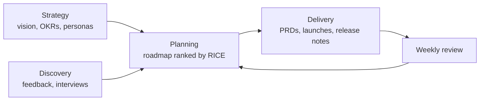

# Product HQ

Everything a product team needs in one place. Strategy sits at the top, customer evidence underneath it, and a roadmap is ranked by evidence rather than by whoever asked loudest. The specs and rituals that turn that roadmap into shipped work live here too.

The workspace comes with a worked example. **${product}** is a fictional analytics product for operations teams, planning its next quarter, so every page and view already has something in it. Read it as a walkthrough, then make it yours.

## How it fits together

- **Strategy**: [[Vision and strategy|doc:documents/Strategy/Vision%20and%20strategy.md]], [[OKRs|doc:documents/Strategy/OKRs.md]] and [[Personas|doc:documents/Strategy/Personas.md]] cover why you build, for whom, and how you will know it worked.
- **Discovery**: the **Feedback** database collects every request with its source, segment and theme. Interview notes like [[Brightwater Logistics|doc:documents/Discovery/Customer%20interview%20-%20Brightwater%20Logistics.md]] sit beside it.
- **Planning**: the **Roadmap** database is the hub. Open it as a Now / Next / Later board, a timeline, a table ranked by RICE score, or the impact-versus-effort matrix. The [[Weekly product review|doc:documents/Planning/Weekly%20product%20review.md]] and the [[Quarterly roadmap review|doc:documents/Planning/Quarterly%20roadmap%20review.slides.md]] deck live here too.
- **Delivery**: a filled-in [[PRD for Saved dashboards|doc:documents/Delivery/PRD%20-%20Saved%20dashboards.md]], its [[launch plan|doc:documents/Delivery/Launch%20plan%20-%20Saved%20dashboards.md]] and the running [[Release notes|doc:documents/Delivery/Release%20notes.md]].
- **Templates**: blank pages to duplicate: [[PRD template|doc:documents/Templates/PRD%20template.md]], [[Launch plan template|doc:documents/Templates/Launch%20plan%20template.md]] and [[Status digest template|doc:documents/Templates/Status%20digest%20template.md]].

## Your first 15 minutes

- [ ] Read [[Vision and strategy|doc:documents/Strategy/Vision%20and%20strategy.md]] (five minutes, and it frames everything else)
- [ ] Open **Planning → Roadmap** and switch between the Board, Timeline, By RICE and Matrix views
- [ ] On the Matrix view, click a dot and move an initiative from Next to Now
- [ ] Add one piece of real customer feedback to **Discovery → Feedback**
- [ ] Skim the sample PRD, then duplicate the [[PRD template|doc:documents/Templates/PRD%20template.md]] for your own next initiative
- [ ] Type `/status_digest` on a new page and watch it write this week's update

## How the pieces connect

Feedback is evidence. Each feedback row links to the roadmap initiative it supports, and each initiative lists the feedback behind it, so "why are we building this?" always has an answer one click away.

The roadmap is ranked by **RICE**: Reach × Impact × Confidence ÷ Effort. The score is a formula column, so changing an estimate re-ranks the list immediately. Use it to start the conversation, not to end it.

Specs hang off the roadmap. When an initiative moves to **Now** it gets a PRD from the template. When it ships, it gets a release note and moves to **Shipped**, and the progress widget on the home page moves with it.

## Make it yours

The Lumen example lives in the Feedback and Roadmap rows, the Saved dashboards PRD and launch plan, the interview note, the weekly review and the release notes. Delete rows freely: the columns, views and the RICE formula stay.

The product name, the north-star metric and the pricing are **workspace variables**. Change them once and every page that mentions them updates, including the market-size figures in the strategy.

## Use with AI

- `/prd_draft` turns a roadmap initiative and the feedback behind it into a first-draft PRD, using the PRD template.
- `/status_digest` writes this week's status update from the roadmap and the weekly review.
- `/feedback_themes` clusters new feedback into themes and suggests which initiatives it supports.

Coding agents can work here too. Point Claude Code or Cursor at this workspace folder over MCP, and they can read the PRD and acceptance criteria, then update an initiative's status when the work ships.

## Suggested routines

Routines can't come inside a template, but these three take a minute to set up:

| When | Run | Why |
|---|---|---|
| Monday, 9:00 | `/status_digest` | The digest is ready before the weekly review starts |
| Friday, 16:00 | `/feedback_themes` | New feedback gets triaged while it's fresh |
| First Monday of the month | "Score the OKRs page and flag key results under 0.4" | No quarter ends with a surprise |
