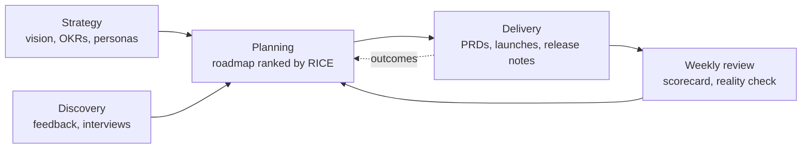

# Product HQ

Everything a product team needs in one place. Strategy sits at the top, customer evidence underneath it, and a roadmap is ranked by evidence rather than by whoever asked loudest. The specs and rituals that turn that roadmap into shipped work live here too.

Most roadmaps never check themselves. This one does: it tells you when a team has signed up for more than it can build, when an initiative has no customer and no goal behind it, whether the quarter's key results are on pace, and how often your confident bets actually come true.

The workspace comes with a worked example. **${product}** is a fictional analytics product for operations teams, planning its next quarter, so every page and view already has something in it. Read it as a walkthrough, then make it yours.

## How it fits together

- **Strategy**: [[Vision and strategy|doc:documents/Strategy/Vision%20and%20strategy.md]], [[OKRs|doc:documents/Strategy/OKRs.md]] and [[Personas|doc:documents/Strategy/Personas.md]] cover why you build, for whom, and how you will know it worked. The key results live in the **Key results** database: its **Scorecard** shows progress, pace to the end of the quarter and a one-click weekly check-in, with every check-in kept in **KR check-ins**.
- **Discovery**: the **Feedback** database collects every request with its source, segment, theme and the **Initiative** it supports. Interview notes like [[Brightwater Logistics|doc:documents/Discovery/Customer%20interview%20-%20Brightwater%20Logistics.md]] sit beside it.
- **Planning**: the **Roadmap** database is the hub. Open it as a Now / Next / Later board, a timeline, a table ranked by RICE score, the impact-versus-effort matrix, or the **Reality check**. The [[Weekly product review|doc:documents/Planning/Weekly%20product%20review.md]] and the [[Quarterly roadmap review|doc:documents/Planning/Quarterly%20roadmap%20review.slides.md]] deck live here too.
- **Delivery**: a filled-in [[PRD for Saved dashboards|doc:documents/Delivery/PRD%20-%20Saved%20dashboards.md]], its [[launch plan|doc:documents/Delivery/Launch%20plan%20-%20Saved%20dashboards.md]] and the running [[Release notes|doc:documents/Delivery/Release%20notes.md]].
- **Templates**: blank pages to duplicate: [[PRD template|doc:documents/Templates/PRD%20template.md]], [[Launch plan template|doc:documents/Templates/Launch%20plan%20template.md]] and [[Status digest template|doc:documents/Templates/Status%20digest%20template.md]].

## Your first 15 minutes

- [ ] Read [[Vision and strategy|doc:documents/Strategy/Vision%20and%20strategy.md]] (five minutes, and it frames everything else)
- [ ] Open [[OKRs|doc:documents/Strategy/OKRs.md]]: which key result is at risk, and which is ahead? Press **Check in** on one and give it a new number
- [ ] Open **Planning → Roadmap → Reality check**. On **Will it fit?**, find the team that's over capacity
- [ ] On **Why this?**, link the unclaimed "Pin three KPIs" request to KPI pins, and watch KPI pins stop being a guess
- [ ] On **Did it work?**, see why this team's 0.8 bets behave like 0.4s
- [ ] Add one piece of real customer feedback to **Discovery → Feedback**
- [ ] Type `/premortem` on the Guided first dashboard row, or `/status_digest` on a new page

## How the pieces connect

**Feedback is evidence.** Each feedback row names the initiative it supports in its **Initiative** column, so the Reality check can count who asked for what. An initiative with no customer and no objective behind it gets flagged.

**The roadmap is ranked by RICE**: Reach × Impact × Confidence ÷ Effort, where Effort is in **person-weeks**. The score is a formula column, so changing an estimate re-ranks the list immediately. Use it to start the conversation, not to end it.

**Now and Next have to fit.** Set each team's capacity in person-weeks on **Will it fit?** and the Reality check draws the cut line: what's below it, and what from Later would fit in the spare.

**Every shipped initiative was a bet.** Write the bet in the PRD, and four weeks after launch set **Outcome** to Hit, Partial or Missed. **Did it work?** compares your outcomes with the Confidence you gave each bet, so your next RICE scores get more honest.

**Key results move weekly.** Owners check in one number each on Monday; the scorecard projects each key result to the end of the quarter from its last four check-ins.

Specs hang off the roadmap. When an initiative moves to **Now** it gets a PRD from the template. When it ships, it gets a release note and moves to **Shipped**, and the progress widget on the home page moves with it.

## Make it yours

The Lumen example lives in the Feedback, Roadmap and Key results rows, the KR check-ins, the Saved dashboards PRD and launch plan, the interview note, the weekly review and the release notes. The shipped roadmap rows are last quarter's bets, there so **Did it work?** has a track record to show. Delete rows freely: the columns, views and formulas stay. Team capacities are set in the Reality check view itself.

The product name, the north-star metric and the pricing are **workspace variables**. Change them once and every page that mentions them updates, including the market-size figures in the strategy.

## Use with AI

- `/prd_draft` turns a roadmap initiative and the feedback behind it into a first-draft PRD, using the PRD template.
- `/status_digest` writes this week's status update from the roadmap and the weekly review.
- `/feedback_themes` clusters new feedback into themes and suggests the Initiative for each row.
- `/premortem` imagines an initiative has failed six months from now and works out why, from your evidence and your missed bets, with a cheap test for each risk.
- `/say_no` drafts a kind, specific "not now" to a customer request, and tells you how to file it.

Coding agents can work here too. Point Claude Code or Cursor at this workspace folder over MCP, and they can read the PRD and acceptance criteria, then update an initiative's status when the work ships.

## Suggested routines

Routines can't come inside a template, but these three take a minute to set up:

| When | Run | Why |
|---|---|---|
| Monday, 9:00 | `/status_digest` | The digest is ready before the weekly review starts |
| Friday, 16:00 | `/feedback_themes` | New feedback gets triaged while it's fresh |
| First Monday of the month | "Find Shipped roadmap rows with no Outcome that ended four or more weeks ago, and draft What happened from the key results" | Every bet gets a verdict, so the calibration stays honest |
