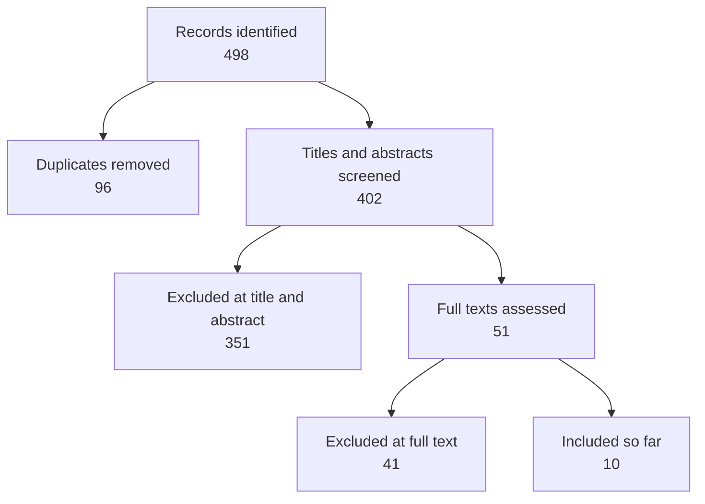

# Search log

Every search, written down well enough that someone else could run it again and get the same results. This is what makes a literature review defensible: when a reader asks "how did you find these?", the answer is this page.

## Concept blocks

Combine the blocks with AND; terms inside a block are joined with OR.

| Block | Terms |
|---|---|
| Garden | "community garden*", allotment*, "urban agriculture", "shared garden*" |
| Wellbeing | wellbeing, "well-being", "mental health", "life satisfaction", stress, "physical activity", diet, "vegetable intake" |
| Social | "social cohesion", "social capital", belonging, trust, neighbo*r* |
| Access | equity, exclusion, gentrification, tenure, "waiting list*" |

## Searches

| # | Week | Where | Search | Limits | Hits | Kept |
|---|---|---|---|---|---|---|
| 1 | 1 | Scopus | Garden AND Wellbeing | 2010 onwards, English | 142 | 9 |
| 2 | 1 | Web of Science | Garden AND Wellbeing | 2010 onwards, English | 118 | 4 |
| 3 | 1 | PubMed | Garden AND (diet OR "vegetable intake" OR "physical activity") | 2010 onwards | 37 | 2 |
| 4 | 2 | Google Scholar | "community garden" "social cohesion" neighbourhood | First 100 results | 100 | 5 |
| 5 | 2 | Council and charity reports | "community garden" evaluation | None | 22 | 3 |
| 6 | 3 | Backward citations | Reference list of Okafor and Lindgren | None | 31 | 4 |
| 7 | 3 | Forward citations | Papers citing Hartmann and colleagues | None | 48 | 2 |

**Pages:** [[Okafor and Lindgren|doc:documents/Sources/Sources/Digging%20in%20together.md]] · [[Hartmann and colleagues|doc:documents/Sources/Sources/Green%20prescriptions.md]]

"Kept" means kept for full-text screening. Duplicates across databases are removed before screening.

## Screening so far

Full-text exclusions so far: not urban (14), no wellbeing or access outcome (12), clinical or therapeutic setting (10), not in English (5).

The sample Sources database holds the ten included sources plus one full-text exclusion, kept to show how a screening decision is recorded. In a real review, give every full text you assess a row, so your exclusions are documented too.

## Next searches

- [ ] Access block on its own: Garden AND Access, because the first round found almost nothing on who is left out
- [ ] Grey literature from housing associations, which run many estate gardens
- [ ] Forward citations of [[Castellanos and Whitfield|doc:documents/Sources/Sources/Neighbours%20over%20the%20fence.md]] once it is read

## Notes

- Week 2: Google Scholar ranks by citations, so recent work is under-represented. Re-run search 4 sorted by date in week 8.
- Week 3: Search 1 missed "allotment" in titles that only said "plots". Added "shared garden*" to the Garden block for the next round.
