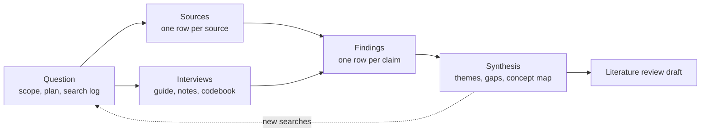

# Research Lab

A workspace for one research project, from the first question to the first draft. You cast a wide net, keep every source and every claim in a database you can sort and filter, then turn the pile into themes, gaps and an argument. Nothing gets lost between reading and writing, because every sentence in the draft can point back to the claim and the source behind it.

It comes with a worked example: **${study_title}**, a fictional twelve-week study run by Nadia Ferreira for a city parks committee deciding whether to fund three new community gardens.

> ==Every source in this workspace is a fictional sample.== The authors, journals, findings and interview participants were invented to show how the pieces fit together. Each source row starts with "Sample source, fictional". Please don't cite them; replace them with your own.

## How it fits together

- **Question**: [[Question and scope|doc:documents/Question/Question%20and%20scope.md]] pins down what you are asking and what counts as in scope. The [[Research plan|doc:documents/Question/Research%20plan.md]] sets the twelve weeks, the [[Search log|doc:documents/Question/Search%20log.md]] records every search so it can be repeated, and the [[Interview guide|doc:documents/Question/Interview%20guide.md]] and the **Codebook** sheet cover the interviews.
- **Sources**: the **Sources** database is the hub. One row per source, with authors, year, type, reading status, relevance, topics, a link and the full citation. Open it as a reading board, a library table, a chart by year, or the **Cite** view.
- **Findings**: the **Claims and evidence** database holds one claim per row, linked to its source and marked Supports, Mixed or Contradicts. [[Interview notes - P04|doc:documents/Findings/Interview%20notes%20-%20P04.md]] shows a coded interview.
- **Synthesis**: [[Themes and gaps|doc:documents/Synthesis/Themes%20and%20gaps.md]] holds the synthesis matrix and the open questions, the [[Concept map|doc:documents/Synthesis/Concept%20map.moodboard.md]] lays claims and sources out on a board, and the [[Literature review draft|doc:documents/Synthesis/Literature%20review%20draft.md]] is where it all becomes prose.
- **Templates**: [[Source notes|doc:documents/Templates/Source%20notes.md]] and [[Interview notes|doc:documents/Templates/Interview%20notes.md]], ready to duplicate.

## Your first 15 minutes

- [ ] Read [[Question and scope|doc:documents/Question/Question%20and%20scope.md]]. Five minutes, and every other page depends on it
- [ ] Open **Sources → Sources** and drag a source from To read to Reading on the board
- [ ] Switch to the **Cite** view, pick a source, and copy its APA 7 reference
- [ ] Open a Cited source, such as [[Green prescriptions|doc:documents/Sources/Sources/Green%20prescriptions.md]], to see the reading-notes structure
- [ ] Open **Findings → Claims and evidence** and look at the Evidence balance chart
- [ ] Type `/find_gaps` on a new page and see what the evidence is missing

## How the pieces connect

**Question first.** The scope page sets inclusion and exclusion criteria. Screening decisions in the Sources database cite them, so an excluded source always says why, like [[Therapeutic horticulture after stroke|doc:documents/Sources/Sources/Therapeutic%20horticulture%20after%20stroke.md]].

**Sources are rows, not files in a folder.** Each one carries its citation fields, so the citation formatter can build a reference in any style. Its body holds your reading notes: summary, key claims, method, quotes and your own thoughts.

**Claims are the unit of synthesis.** A claim is one sentence you might write in the review, with the evidence behind it. Each claim row links to its source, and each source lists the claims it produced. The stance and strength columns feed a *Weight* formula, so the Evidence balance chart shows which themes are well supported and which are contested.

**Themes come from claims, and gaps come from themes.** The synthesis matrix shows which sources speak to which theme. Empty cells become gaps, gaps become new searches in the search log, and new searches bring new sources.

**Capture from anywhere.** Export a collection from Zotero as CSV and ask Claude to add one row per reference, or paste a citation and let it fill the columns. Import a PDF and Hillnote turns it into a markdown page you can highlight, quote and link to from the source row.

## Where the study is now

Week 6 of 12. ${sources_read} of ${target_sources} planned sources read (${=round(sources_read / target_sources * 100)}%), ${interviews_done} of ${interviews_planned} interviews done, ${=interviews_planned - interviews_done} to go.

## Make it yours

The sample study lives in the Sources and Claims rows, the codebook, the interview note, the search log and the synthesis pages. Delete the rows when you are ready: the columns, views, formulas and the Cite view stay.

The study title, source target, interview counts and survey population are **workspace variables**. Change them once and every page that mentions them updates, including the progress figures above and the survey sample size in the research plan.

## Use with AI

- `/synthesize` reads the sources you have read and the claims you have logged, then drafts themed synthesis paragraphs with citations, saying where the evidence agrees and where it doesn't.
- `/critique_source` appraises one source: design, sample, bias and fit with your question. It also cross-checks every claim you logged from it against your notes.
- `/find_gaps` compares your question with your evidence and suggests new searches and interview probes.

Point Claude Code or Cursor at this workspace folder over MCP and it can do the heavy lifting: add a row per reference from a Zotero export, pull the claims out of a long PDF you imported, or check that every claim in the draft still has a source.

## Suggested routines

Routines can't come inside a template, but these take a minute to set up:

| When | Run | Why |
|---|---|---|
| Friday, 16:00 | `/synthesize` | The week's reading becomes paragraphs while you remember it |
| Every second Monday | `/find_gaps` | New gaps turn into new searches before the window closes |
| After each interview | `/critique_source` on the interview note | Catches leading questions and thin evidence early |
