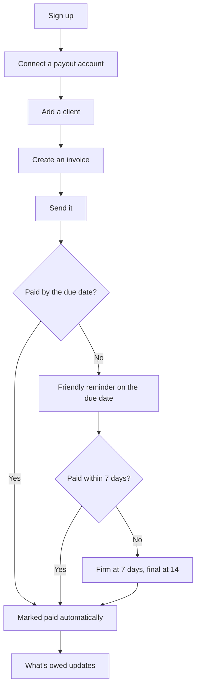

# MVP spec

> The smallest ${product_name} that keeps its promise: **send an invoice in a minute, and get paid without chasing.** Anything that doesn't serve that sentence waits until after launch.

:::toc "On this page"
:::

## Who it's for

Solo freelancers with many clients and at least one late invoice a month. The early adopter is a freelance designer billing agencies on 30 to 60 day terms. Evidence: the **Customer interviews** database, summarised on the [[Lean canvas|doc:documents/Strategy/Lean%20canvas.md]].

## The user flow

The screens for this flow are mocked in Figma before they're built. Paste the Figma file link here with `/figma` and it embeds right on this page, so the spec and the mock sit together when a coding agent reads them.

## Requirements

Each group maps to a milestone on the Build board. Every card links back to its section here.

### Invoices

| # | Requirement | Acceptance |
|---|---|---|
| I1 | Create an invoice from a saved client | First invoice in under 2 minutes for a new user, under 1 minute after that |
| I2 | Line items, tax rate, due date, notes | Totals are right to the cent; tax can be zero |
| I3 | PDF that prints well | A4 or US Letter by the client's country; nothing splits across pages |
| I4 | Invoice numbers in sequence | No gaps, no duplicates, editable starting number |

### Getting paid

| # | Requirement | Acceptance |
|---|---|---|
| P1 | Connect a payout account | Onboarding can be finished later; invoices can't be sent until it's done |
| P2 | A pay-by-card link on every invoice | The client pays without creating an account |
| P3 | Paid status updates by itself | Within a minute of payment; a payment is never counted twice |
| P4 | Mark paid by hand | For bank transfers and cash, with a date |

### Reminders

| # | Requirement | Acceptance |
|---|---|---|
| R1 | Reminder schedule per invoice | Default: due date, +7 days, +14 days; each step can be switched off |
| R2 | Three tones: friendly, firm, final | Every email is previewed before the first send |
| R3 | Stop the moment it's paid | No reminder ever goes out after payment |
| R4 | Sent from the freelancer's name | Replies go to the freelancer, not to ${product_name} |

### Dashboard

| # | Requirement | Acceptance |
|---|---|---|
| D1 | One number: what you're owed | Splits into due and overdue |
| D2 | Who owes what | Sorted by days overdue |

## Out of scope for launch

In rough order of who asked first:

1. **Deposits and split payments**, for photographers ([[Tom|doc:documents/Strategy/Customer%20interviews/Tom%20-%20wedding%20photographer.md]])
2. **Recurring invoices** for monthly retainers
3. **Multi-currency**: one currency per account until there's demand
4. **Client list import**: done by hand in the beta first (assumption 7)
5. Expenses, time tracking, team accounts, and anything an accountant would call "accounting"

Saying no here is what makes launching in ten weeks possible.

## Data model

| Thing | Key fields |
|---|---|
| Client | name, email, country, default terms |
| Invoice | number, client, line items, tax, due date, status (draft, sent, paid, void) |
| Reminder | invoice, step, tone, scheduled for, sent at |
| Payment | invoice, amount, method (link or manual), provider event id |

## Non-functional

- **Email lands in the inbox.** Authenticated sending domain, plain-text version of every email, no tracking pixels.
- **Money is exact.** Amounts stored in cents; never floats.
- **Payments are idempotent.** Every provider event id is stored once; repeats are ignored.
- **One person can run it.** No feature ships without the alert that tells you it broke.

## Definition of done

- [ ] Works end to end in test mode with a real email inbox
- [ ] Empty, error and loading states exist
- [ ] A line in the [[Ship log|doc:documents/Build/Ship%20log.md]]
- [ ] The card moves to Done on the Build board

## Building it with a coding agent

Point Claude Code or Cursor at this workspace over MCP, with the code repository open beside it. A good prompt names one card and this page: *"Read the MVP spec and the Build board card for automatic payment reminders, then implement R1 to R3. Ask before changing the data model."* When the work is merged, ask it to move the card to Done and add a line to the ship log.
