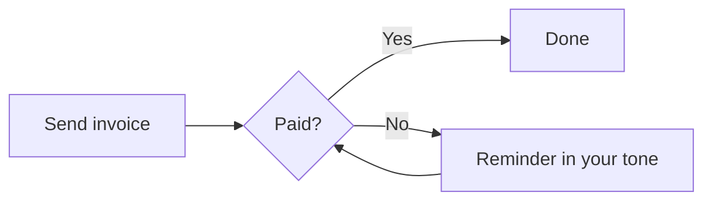

# Harbor

~

Invoices that chase themselves · pre-launch update

***

## The problem

Freelancers do the work, send the invoice, then **chase it by hand**.

- 5 of 6 freelancers we interviewed raised chasing before we asked
- 19 days late, on average, for the last late invoice they described
- One had $6,400 outstanding on the day we spoke

***

~bg-14324b
~text-ffffff

> "I send the invoice, then I wait, then I feel awkward, then I wait more."

~

A brand designer, interview 1

***

## What Harbor does

1. **Send** an invoice in under a minute, from a saved client
2. **Get paid** through a card link on every invoice, with no account for the client
3. **Follow up** automatically: friendly, firm, final, and stop the moment it's paid

***

## How it works

***

## Early signal

~bar

| Week | Waitlist sign-ups |
|---|---|
| Week 2 | 38 |
| Week 3 | 61 |
| Week 4 | 29 |
| Week 5 | 34 |
| Week 6 | 27 |
| Week 7 | 23 |

212 on the waitlist from two community posts and one newsletter. 8 paid before launch.

***

## Business model

**One plan, $12 a month.** 14-day trial, no card.

- Break-even on running costs: 7 customers
- The goal: 400 customers, $4,800 MRR
- Costs stay flat: one person, about $76 a month in tools

***

## Why not the alternatives

| | Reminders | Card link | Setup |
|---|---|---|---|
| Spreadsheet and template | No | No | 20 min |
| Accounting suite | Generic | Add-on | 45 min |
| Free invoice maker | No | No | 5 min |
| **Harbor** | **3 tones** | **Yes** | **2 min** |

***

## The next three weeks

1. **Reminders**: schedule, tones, never after payment
2. **Private beta**: 12 freelancers, real clients, two weeks
3. **Launch**: the Tuesday of week 10

***

## The ask

Not money. Harbor is bootstrapped.

- **Beta users**: freelancers who chased an invoice this month
- **Introductions**: bookkeepers who work with freelancers
- **Honest feedback** on the reminder emails
