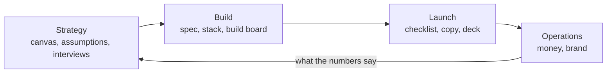

# Solo Builder HQ

One person, one product, one folder. The strategy, the build board, the launch plan and the money all live here as plain markdown, so you and your AI tools always work from the same page.

The workspace comes with a worked example. **${product_name}** is a fictional invoicing app for freelancers, built by one person: Ines, a freelance designer who got tired of chasing late payments. It's **week 7 of 10**. Invoices and PDFs work, card payments are nearly done, reminders start this week and launch is three weeks away. Read it as a walkthrough, then make it yours.

## How it fits together

- **Strategy**: the [[Lean canvas|doc:documents/Strategy/Lean%20canvas.md]] on one screen, [[Assumptions to test|doc:documents/Strategy/Assumptions%20to%20test.md]] ranked by risk, [[Competitor notes|doc:documents/Strategy/Competitor%20notes.md]], and the **Customer interviews** database (a table, cards, and pain by segment).
- **Build**: the [[MVP spec|doc:documents/Build/MVP%20spec.md]] with the user flow, the [[Tech stack|doc:documents/Build/Tech%20stack.md]], the weekly [[Ship log|doc:documents/Build/Ship%20log.md]] and the hub, the **Build board**, which opens as a board, a roadmap, this week's list, a calendar or effort by milestone.
- **Launch**: the [[Launch checklist|doc:documents/Launch/Launch%20checklist.md]], [[Landing page copy|doc:documents/Launch/Landing%20page%20copy.md]], [[Announcement drafts|doc:documents/Launch/Announcement%20drafts.md]] for every channel, and a short [[Pitch deck|doc:documents/Launch/Pitch%20deck.slides.md]].
- **Operations**: [[Runway and goals|doc:documents/Operations/Runway%20and%20goals.md]] with the **Money** sheet and two calculators, and the [[Brand board|doc:documents/Operations/Brand%20board.moodboard.md]] with the palette, type and voice.
- **Templates**: blank pages to duplicate: [[Feature spec template|doc:documents/Templates/Feature%20spec%20template.md]], [[Interview notes template|doc:documents/Templates/Interview%20notes%20template.md]] and [[Weekly review template|doc:documents/Templates/Weekly%20review%20template.md]].

## Your first 15 minutes

- [ ] Read the [[Lean canvas|doc:documents/Strategy/Lean%20canvas.md]]. It's one screen and it frames everything else.
- [ ] Open **Build → Build board** and switch between Board, Roadmap, This week and Calendar
- [ ] Drag a card from This week to Doing, then watch the progress widget on the home page
- [ ] Add one real conversation to **Strategy → Customer interviews**, using the interview notes template
- [ ] Open [[Runway and goals|doc:documents/Operations/Runway%20and%20goals.md]] and put your own numbers into the runway calculator
- [ ] Type `/pressure_test` on a new page and let it argue with your idea

## From idea to launch

The way this workspace is meant to be used, start to finish:

1. **Brainstorm with Claude.** Fill in the canvas, then run `/pressure_test` to find the assumption most likely to sink you.
2. **Talk to people.** Every conversation becomes a row in Customer interviews; the quotes feed the canvas, the spec and the landing page.
3. **Mock it in Figma.** Sketch the screens in the MVP spec's user flow, then paste the Figma link into the spec with `/figma` so the mock sits beside the requirements.
4. **Plan in markdown.** The spec says what; each Build board card says when, links to its spec section and carries its own acceptance criteria.
5. **Build with a coding agent.** Point Claude Code or Cursor at this folder over MCP, next to your code. It reads the spec and the card, writes the code, and moves the card to Done.
6. **Document and launch.** Draft the landing page in your customers' words, publish it, and work through the launch checklist.

## How the pieces connect

**Evidence flows up.** Interview rows are quoted on the canvas, in the assumptions and on the landing page, so every claim has a person behind it.

**Work flows down.** The MVP spec is split into milestones; every Build board card links to its section of the spec. The **Due** column is a formula: it says "Due tomorrow", "3 days left" or "Overdue" from the card's end date, and "Shipped" once it's Done.

**Fridays close the loop.** The ship log records what shipped, what you learned and next week's three cards. The Money sheet gets a row each month, and the runway calculator tells you whether you're default alive.

## Make it yours

The ${product_name} story lives in the interview rows, the Build board cards, the ship log, the Money sheet, the launch pages, the pitch deck and the brand board. Delete rows freely: the columns, the views and the Due formula stay put.

The product name, the price, the customer goal and the monthly running costs are **workspace variables**. Change them once and every page follows: right now the goal works out at **$${=price_monthly * target_customers} MRR**. The pitch deck and the announcement drafts use typed numbers, so update those by hand.

## Use with AI

- `/pressure_test` reads the canvas, the assumptions and the interviews, then names the three risks most likely to sink you and a one-week test for each.
- `/weekly_ship_review` drafts Friday's ship log entry from the Build board: what shipped, what's slipping, and next week's three.
- `/landing_copy` rewrites the landing page in your customers' own words from the interview quotes.

Coding agents work here too. Point Claude Code or Cursor at this workspace folder over MCP: they can read the MVP spec and a card's acceptance criteria, then move the card to Done and add a line to the ship log when the work ships.

## Suggested routines

Routines can't come inside a template, but these take a minute to set up:

| When | Run | Why |
|---|---|---|
| Friday, 16:00 | `/weekly_ship_review` | The ship log writes itself while the week is fresh |
| Monday, 9:00 | "Pick three cards for this week from the Build board and move them to This week" | A small, honest plan beats a long list |
| First of the month | "Add last month's row to the Money sheet and tell me if I'm default alive" | Runway never surprises you |
| After every third interview | `/pressure_test` | The canvas keeps up with the evidence |
