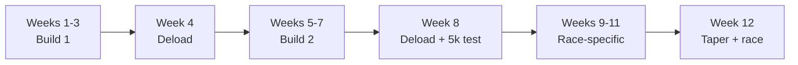

# Training plan

Twelve weeks to run the **${race_name}** in under ${goal_10k_min} minutes, while keeping the strength built over the summer. Three runs and two strength sessions a week, a deload every fourth week, and a taper at the end.

> Not medical advice. If something hurts in a way that training doesn't usually hurt, stop and see a physiotherapist or doctor.

:::toc "On this page"
:::

## Goals

| Goal | Start of block | Target |
|---|---|---|
| 10k race time | 53:40 | Under ${goal_10k_min}:00, which is ${=goal_10k_min / 10} minutes per km |
| Back squat, estimated 1RM | 87.5 kg | 100 kg |
| Deadlift, estimated 1RM | 116.7 kg | 130 kg |
| Bench press, estimated 1RM | 58.3 kg | 65 kg |
| Weekly running | 23 km | 34 km at peak |

The running goal comes first. Strength work is there to make the running more durable and to keep the gym numbers from sliding, so when the two clash, the run wins.

## The block

| Week | Phase | Running | Strength |
|---|---|---|---|
| 1–3 | Build 1 | 23 → 28 km, intervals at 5k pace | 5×5 squat and bench, 3×5 deadlift, add weight weekly |
| 4 | Deload | 18 km, all easy, strides only | 3 sets at about 90% of last week's weight |
| 5–7 | Build 2 | 27 → 30 km, more intervals | Keep adding weight while RPE stays at 8 or below |
| 8 | Deload | 20 km, a 5 km time trial on Saturday | 3 sets, lighter |
| 9–11 | Race-specific | 31 → 34 km, intervals at 10k pace | 3×3 heavy, lower volume |
| 12 | Taper | 16 km, then the race on Sunday | One light session early in the week |

We are in **week ${current_week}**, the last week of Build 2. ${=block_weeks - current_week} weeks to go.

## The weekly template

| Day | Session | Intensity |
|---|---|---|
| Mon | Mon - Strength A: squat, bench, accessories | Hard |
| Tue | Tue - Easy run: 45 minutes, conversational | Easy |
| Wed | Wed - Mobility and core | Easy |
| Thu | Thu - Intervals: the week's hard run | Hard |
| Fri | Fri - Strength B: deadlift, press, single-leg work | Hard |
| Sat | Sat - Rest | Rest |
| Sun | Sun - Long run: the week's longest run, easy | Easy |

**Pages:** [[Mon - Strength A|doc:documents/Plan/Sessions/Mon%20-%20Strength%20A.md]] · [[Tue - Easy run|doc:documents/Plan/Sessions/Tue%20-%20Easy%20run.md]] · [[Wed - Mobility and core|doc:documents/Plan/Sessions/Wed%20-%20Mobility%20and%20core.md]] · [[Thu - Intervals|doc:documents/Plan/Sessions/Thu%20-%20Intervals.md]] · [[Fri - Strength B|doc:documents/Plan/Sessions/Fri%20-%20Strength%20B.md]] · [[Sat - Rest|doc:documents/Plan/Sessions/Sat%20-%20Rest.md]] · [[Sun - Long run|doc:documents/Plan/Sessions/Sun%20-%20Long%20run.md]]

The two hardest leg days are Monday (squats) and Thursday (intervals), with an easy day between. Deadlifts come on Friday, two days before the long run.

## The rules

### Run mostly easy: 80/20

[About 80% of running time is easy]{#eighty-twenty}: you can talk in full sentences, roughly RPE 3 to 4. The other 20% is genuinely hard: intervals and tempo. Most runners get this wrong by running their easy days too fast, which leaves them too tired to run the hard days properly. The **80/20 check** view in Sessions adds up your easy and hard running time. It counts a whole interval session as hard, warm-up and cool-down included, so a chart showing about 70/30 is close to 80/20 in real time-in-zone.

### Add load slowly

[Progressive overload]{#progression} for the main lifts:

1. When you complete every set and rep at RPE 8 or below, add 2.5 kg next time (deadlift: 5 kg until week 4, then 2.5 kg).
2. If you miss reps, repeat the weight next session.
3. If you miss reps at the same weight two sessions in a row, drop the weight by 10% and build back up.

For runs, add no more than about 10% to the weekly distance, and keep the long run at or below 30% of the week's total.

### Use RPE

| RPE | Lifting | Running |
|---|---|---|
| 10 | Nothing left | All-out race finish |
| 9 | One more rep possible | Hard intervals, last rep |
| 8 | Two more reps possible | Intervals, 5k pace |
| 7 | Three more reps possible | Tempo, 10k pace |
| 5–6 | Warm-up sets | Steady, half-marathon effort |
| 3–4 | | Easy, conversational |

### Deload every fourth week

[A deload]{#deload} cuts volume by about 40% and keeps some intensity: fewer sets at slightly lighter weights, all easy running plus strides. Deloads are planned, not earned. Take one early if two or more of these show up in the same week:

- Estimated 1RM down for two sessions in a row on any main lift
- The same work feels at least one RPE point harder
- Resting heart rate 5 or more beats above your baseline for most of the week
- Average sleep under 7 hours
- Energy at 2 or below in two or more sessions

`/deload_check` reads all of this for you, and every page tagged #deload or #plateau shows up together under those topics.

### Keep running and lifting from fighting

- Put hard runs and heavy leg days on different days, or at least six hours apart.
- Lift after an easy run, never before a hard one.
- Keep strength work short: two main lifts and two accessories, under an hour.

## Interval sessions

Thursday's session progresses through the block. Work at about 5k pace, jog the recoveries.

| Weeks | Session | Work | Recovery |
|---|---|---|---|
| 1–3 | 5 × 800 m | 3:50 each | 2:00 jog |
| 5–6 | 5 × 800 m | 3:45 each | 2:00 jog |
| 7 | 6 × 800 m | 3:45 each | 2:00 jog |
| 9–11 | 3 × 2 km at 10k pace | 9:50 each | 3:00 jog |

Run them with the interval timer; the 6 × 800 m preset is already saved.

[html:Interval timer](resources/html/interval-timer/index.html)
