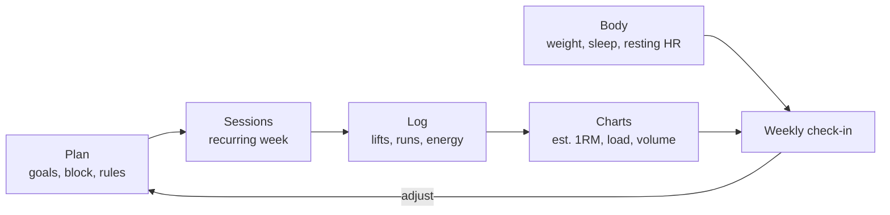

# Training Log

One place for the plan, the work and the proof. Plan the week with recurring sessions beside your goals, log every set, run and how you felt, and let the charts tell you whether it is working: estimated maxes going up, weekly load rising and falling on schedule, resting heart rate behaving.

> ==Not medical advice.== This workspace is a way to organise training, not a prescription. Check with a doctor or a qualified coach before starting a new programme, and stop and get help if something hurts.

It comes with a worked example: a twelve-week block training for the **${race_name}** in under ${goal_10k_min} minutes while keeping strength in the gym. You are in week ${current_week} of ${block_weeks}, with ${=block_weeks - current_week} weeks to race day.

## How it fits together

- **Plan**: the [[Training plan|doc:documents/Plan/Training%20plan.md]] sets the goals, the block structure, deloads and the progression rules. The **Sessions** database is the hub: this week's sessions as a board by day, a calendar, a log, and charts of training load and easy-versus-hard time.
- **Log**: the **Lift log** records every top set and charts estimated one-rep max and weekly volume. The **Exercise library** holds cues and common mistakes for each movement.
- **Body**: the **Body metrics** sheet tracks weight, sleep and resting heart rate week by week, and [[Nutrition|doc:documents/Body/Nutrition.md]] works out your protein target.
- **Review**: the [[Week 6 check-in|doc:documents/Review/Week%206%20check-in.md]] shows a filled-in review, and the [[PR board|doc:documents/Review/PR%20board.md]] keeps your bests.
- **Templates**: [[Weekly check-in|doc:documents/Templates/Weekly%20check-in.md]] and [[Strength session|doc:documents/Templates/Strength%20session.md]], ready to duplicate.

## Your first 15 minutes

- [ ] Read the [[Training plan|doc:documents/Plan/Training%20plan.md]], especially the rules for progressing and deloading
- [ ] Open **Plan → Sessions**. Mark [[Wed - Mobility and core|doc:documents/Plan/Sessions/Wed%20-%20Mobility%20and%20core.md]] as Done on the This week board
- [ ] Switch to the **80/20 check** view: is most of your running time easy?
- [ ] Open **Log → Lift log** and look at the Est. 1RM trend chart. Spot the squat stalling in week 7
- [ ] Open the [[Training plan|doc:documents/Plan/Training%20plan.md]] and try the interval timer with the 6 × 800 m preset
- [ ] Type `/deload_check` on a new page and see what it makes of the last three weeks

## How the pieces connect

**The week repeats itself.** The seven sessions on the This week board are recurring: when you mark one Done, it resets to Planned the following Monday, ready for next week. Anything worth keeping, such as a top set, goes into the Lift log, and one-off sessions (a time trial, a race, a skipped run) get their own rows.

**Every session carries its cost.** Duration × RPE gives a session load, a simple, well-tested way to put a number on how hard a week was. The Weekly load chart should climb for three weeks, then drop in the deload week.

**Lifts chart themselves.** Log weight, sets and reps; the Lift log's formula columns work out estimated one-rep max and volume, and the charts update immediately.

**The check-in closes the loop.** Each week, compare what you planned with what you did, look at sleep, resting heart rate and energy, and make one change. When several warning signs appear at once, take a deload.

## Bring your data in

Point Claude at this workspace over MCP alongside a Strava connector, and it can read your runs and write them into Sessions: date, distance, duration and a first guess at RPE for you to correct. The same works for a watch export or a CSV.

## Make it yours

The sample block lives in the Sessions and Lift log rows, the body metrics, the week 6 check-in and the PR board. Delete the rows when you are ready: the columns, views, formulas, charts and recurring week stay. Keep the seven weekly sessions and edit them into your own routine.

Your race, goal time, block length, current week and bodyweight are **workspace variables**. Change them once and the countdown, goal pace and protein target update everywhere.

## Use with AI

- `/weekly_review` reads this week's sessions, lifts and body metrics and fills in the weekly check-in: planned versus done, load, PRs, trends and one change for next week.
- `/adjust_plan` reworks the next week or two when life gets in the way, keeping the key sessions and the 80/20 balance, without trying to make up missed work.
- `/deload_check` looks for stalled lifts, rising effort, high resting heart rate and poor sleep, and tells you whether to deload now, as planned, or not yet.

Point Claude Code or Cursor at this workspace folder over MCP and it can do the logging too: add this week's runs from Strava, log your sets, or move a session when you travel.

## Suggested routines

Routines can't come inside a template, but these take a minute to set up:

| When | Run | Why |
|---|---|---|
| Sunday, 19:00 | `/weekly_review` | The check-in is written before the new week starts |
| Every fourth Thursday | `/deload_check` | Catches fatigue before it turns into a plateau or an injury |
| Monday, 07:00 | "Add last week's Strava runs to Sessions" | Your run log stays complete without typing |
