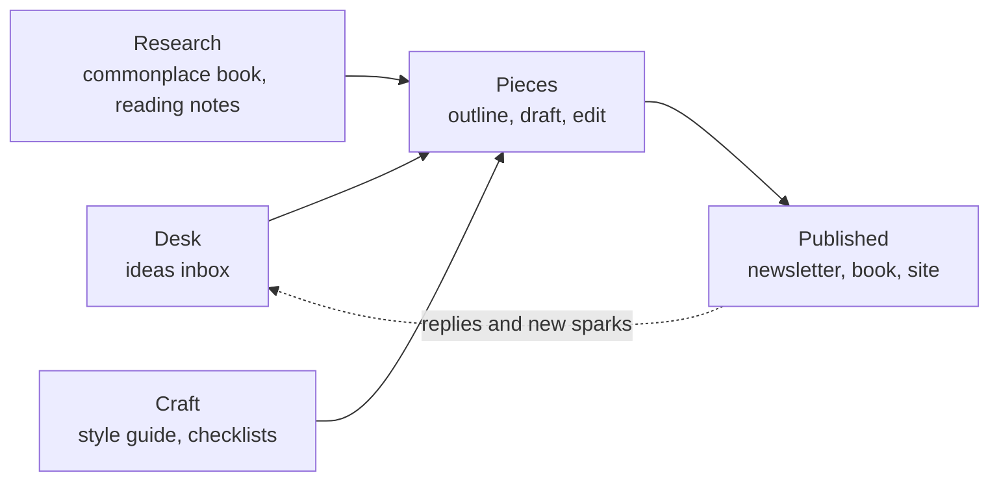

# Writer's Studio

A quiet place to do the whole job of writing: catch the idea, shape it, draft it, cut it, ship it. Ideas land on the Desk, become pieces, and move through a pipeline until they are published. Your research and your rules of craft sit one link away from every draft.

The workspace comes with a worked example. **${pen_name}** is a fictional essayist who sends a fortnightly newsletter, **${newsletter_name}**, and is halfway through a book of essays about repair, *${book_title}*. Every page and view already has something in it. Read it as a walkthrough, then make it yours.

## How it fits together

- **Desk**: the **Ideas** database catches every spark, with where it came from. [[This week at the desk|doc:documents/Desk/This%20week%20at%20the%20desk.md]] holds the week's plan and the sprint timer.
- **Pieces**: the **Pieces** database is the hub. Every essay, newsletter issue and book chapter is a row with a status, a word target and a progress bar. The [[Book plan|doc:documents/Pieces/Book%20plan.md]] and the [[Newsletter plan|doc:documents/Pieces/Newsletter%20plan.md]] sit beside it.
- **Research**: the [[Commonplace book|doc:documents/Research/Commonplace%20book.md]] keeps quotes and overheard lines, tagged by topic, and the **Reading notes** database keeps what you read and where it will be used.
- **Craft**: the rules you edit against. The [[Style guide|doc:documents/Craft/Style%20guide.md]], a four-pass [[Editing checklist|doc:documents/Craft/Editing%20checklist.md]], [[Structure cheat-sheets|doc:documents/Craft/Structure%20cheat-sheets.md]] and a [[Publishing checklist|doc:documents/Craft/Publishing%20checklist.md]].
- **Templates**: blank pages to duplicate, an [[Essay outline|doc:documents/Templates/Essay%20outline.md]] and a [[Newsletter issue|doc:documents/Templates/Newsletter%20issue.md]].

## Your first 15 minutes

- [ ] Open **Pieces → Pieces** and switch between the Pipeline, Calendar and Table views
- [ ] Open [[The cobbler on Wren Street|doc:documents/Pieces/Pieces/The%20cobbler%20on%20Wren%20Street.md]] to see an outline, a draft excerpt and a scratch space working together
- [ ] Add one idea of your own to **Desk → Ideas**, with the spark that started it
- [ ] Run a ten-minute sprint from the **Sprint** view of Pieces and log the words to a piece
- [ ] Paste a paragraph of your own into the readability check at the bottom of the [[Editing checklist|doc:documents/Craft/Editing%20checklist.md]]
- [ ] Select a paragraph in any draft and type `/line_edit`

## How the pieces connect

An idea is cheap and should stay cheap. Catch it on the Desk with its spark and one line on why it matters, then move on. When an idea keeps coming back, promote it: add a row to Pieces, set it to **Outline**, and link the two.

A piece is a page. Its properties track status, type, target and current words, and the **Progress %** formula works out how close the draft is. The body holds whatever the piece needs right now: the outline, the draft, research links, and a scratch space for the half-thoughts you want to keep but not in the draft.

Research feeds pieces through links and topics. Quotes in the commonplace book carry topics such as #craft and #care, so the topic panel gathers everything you have on a theme, from every page, in one place.

Craft pages are what you edit against. The editing checklist runs four passes, from structure down to commas, and the style guide settles arguments before they start. When a piece moves to **Ready**, the publishing checklist takes it the rest of the way: into the newsletter, to the editor, or onto your blog, which Hillnote can publish as a site on your own domain.

## Make it yours

The sample story lives in the Ideas, Pieces and Reading notes rows, the commonplace book, the book and newsletter plans, and this week's desk page. Delete rows freely: the columns, views and the progress formula stay. The Craft pages and the templates are written to be kept; edit them into your own rules.

Your pen name, newsletter name, book title, daily word target and book length are **workspace variables**. Change them once and every page that mentions them updates, including the timeline in the book plan.

## Use with AI

- `/line_edit` tightens a passage against your style guide and the line pass of the editing checklist, then lists what it changed and why.
- `/headline_options` writes headlines, subtitles and email subject lines for the current piece, using the headline patterns in the cheat-sheets.
- `/outline_from_notes` turns a scratch space full of notes into an outline: it picks a structure from the cheat-sheets and pulls matching quotes from the commonplace book.

Give Claude the heavy lifting, such as a structural rewrite or a middle section that has stopped working. Keep the small fixes local: on-device AI handles grammar, tone and quick rewrites in place, and the draft never leaves your machine.

Coding agents and desktop assistants can work here too. Point Claude Code or Cursor at this workspace folder over MCP, and they can read a draft with its research, update a piece's status or word count, and add sparks to the Ideas inbox.

## Suggested routines

Routines can't come inside a template, but these three take a minute to set up:

| When | Run | Why |
|---|---|---|
| Weekdays, 8:30 | "Read This week at the desk and tell me the one thing to write first today" | You sit down knowing what to write |
| Wednesday, 16:00 | `/headline_options` on the next newsletter piece | The subject line is settled before send day |
| Sunday, 18:00 | "Read the Ideas inbox and suggest which two sparks to promote this week" | Good ideas get a hearing before they go stale |
